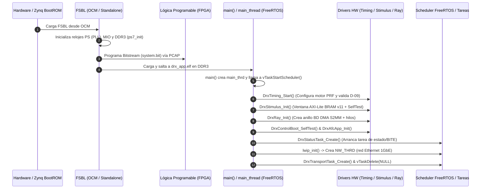

# Secuencia de Arranque e Inicialización

Esta página describe el flujo completo de arranque del sistema LAMULA DRx, desde que se aplica energía a la placa ZedBoard hasta que las tareas de FreeRTOS entran en su bucle de ejecución permanente.

## Secuencia General de Arranque

El proceso de arranque combina la etapa *bare-metal* gestionada por la First Stage Boot Loader (FSBL) de Xilinx con el arranque síncrono del firmware sobre FreeRTOS.

---

## Detalle Paso a Paso de `main_thread`

La función `main_thread()` (`fw/src/app/main.c`) ejecuta la secuencia de inicialización del sistema en un orden estrictamente controlado:

### 1. Inicialización del Motor de Timing (`DrxTiming_Start()`)
- **Ruta:** `fw/src/app/drx_timing_cfg.c`.
- **Por qué ocurre primero:** En *reset*, todos los registros de timing valen `0`. La lógica D-09 rechaza un `pulse_width` de 0 y marca `TIMING_STATUS = 0x6`. Si la tarea de monitoreo de estado arrancara antes, imprimiría falsos positivos de error por UART.
- **Acciones:**
  1. Inhabilita el secuenciador (`DrxReg_TimingDisable()`).
  2. Escribe los parámetros de PRF, ancho de pulso, retardos y cantidad de celdas (*bins*).
  3. Relee los registros por AXI-Lite (`DrxReg_VerifyTimingConfig()`) para descartar fallos en el bus AXI.
  4. Limpia los bits *sticky* de reset en `TIMING_STATUS`.
  5. Habilita el secuenciador (`DrxReg_TimingEnable()`) y confirma que `TRIG_COUNT` incrementa.

### 2. Inicialización de la Ventana de Estímulo (`DrxStimulus_Init()`)
- **Ruta:** `fw/src/app/drx_stimulus.c`.
- **Acciones:** Verifica que la versión del mapa de registros sea 11. Habilita el flag `vector_load` en `CTRL`, carga por AXI-Lite el vector de tono nominal en la BRAM de `vector_source`, fija la longitud a 4000 muestras y ejecuta autopruebas de saturación.

### 3. Inicialización del Anillo DMA y Sumidero de Rayos (`DrxRay_Init()`)
- **Ruta:** `fw/src/app/drx_ray.c`.
- **Acciones:**
  1. Inicializa el controlador AXI DMA (`XAxiDma_CfgInitialize`).
  2. Asigna e invalida la caché para los `DRX_RAY_BUFFERS` (16 buffers circulares en DDR3).
  3. Crea el anillo de descriptores Scatter-Gather (`XAxiDma_BdRingCreate`).
  4. Instala el manejador de interrupción `ray_isr` en el GIC (IRQ ID 61).
  5. Crea la tarea de recepción `drx_ray` (`DrxRayTask_Create()`) y encola los buffers iniciales.

### 4. Autoprueba del Plano de Control y AFC
- **Ruta:** `fw/src/app/drx_control_boot.c` y `fw/src/app/drx_afc_app.c`.
- **Acciones:** Ejercita el reconocedor de tramas del contrato DRx↔DSP con tramas sintéticas antes de abrir cualquier socket de red, verificando que una actualización de AFC cambia la palabra `NCO_PINC` correctamente.

### 5. Arranque de la Tarea de Estado (`DrxStatusTask_Create()`)
- **Ruta:** `fw/src/app/drx_status_task.c`.
- **Acciones:** Inicia la tarea `drx_status` para realizar el sondeo periódico (cada 1000 ms) de los registros de error *sticky* (W1C).

### 6. Inicialización de Red lwIP y Transporte TCP
- **Acciones:**
  1. Invocación de `lwip_init()`.
  2. Creación de la tarea de red `NW_THRD` (`network_thread`).
  3. Adición del adaptador EMAC (`xemac_add`) con dirección IP estática `192.168.1.10`.
  4. Creación de la tarea `DrxTransportTask` que abre el socket servidor TCP en el puerto 5000 (`DRX_DSP_TCP_PORT`).
  5. Eliminación de la tarea `main_thrd` mediante `vTaskDelete(NULL)`.

---

## Admoniciones sobre Trampas Comunes de Arranque

!!! warning "Trampa 1: Intentar comunicar con la PL antes de verificar VERSION"
    Llamar a funciones del driver AXI-Lite sin verificar previamente `DrxReg_Version()` puede causar comportamientos impredecibles si el bitstream cargado en la PL no coincide con el mapa de registros que compiló el firmware.

!!! warning "Trampa 2: Carga de descriptores DMA y coherencia de caché"
    El controlador AXI DMA escribe los rayos directamente en la memoria RAM DDR3 sin pasar por la L1/L2 cache del procesador Cortex-A9. Antes de entregar un buffer al DMA en `submit_buffer()`, es **obligatorio** invalidar el rango de direcciones con `Xil_DCacheInvalidateRange()`; de lo contrario, un *write-back* posterior del procesador sobreescribirá los datos del rayo recién llegado.
