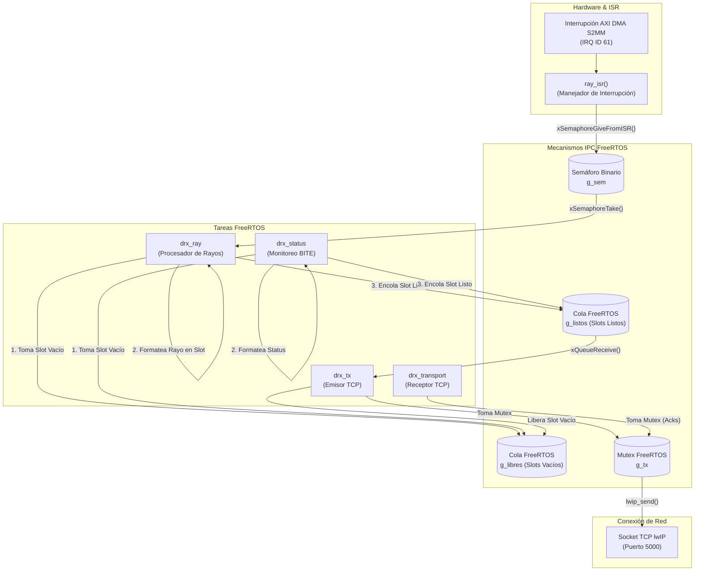

# Comunicación y Sincronización entre Tareas

Para garantizar un funcionamiento libre de condiciones de carrera (*race conditions*) y evitar cuellos de botella en la entrega de datos, el firmware de LAMULA DRx hace uso de tres mecanismos fundamentales de FreeRTOS: **semáforos binarios**, **colas de mensajes** y **semáforos mutex**.

## Diagrama de Comunicación Inter-Proceso (IPC)

La siguiente figura muestra el flujo de datos y sincronización entre las rutinas de interrupción, las tareas productoras de datos y la tarea consumidora de transmisión TCP:



---

## Mecanismos IPC en Detalle

### 1. Semáforo Binario ISR → Tarea (`g_sem`)
- **Archivo:** `fw/src/app/drx_ray.c`.
- **Creación:** `g_sem = xSemaphoreCreateBinary();`.
- **Propósito:** Desconectar la rutina de interrupción del procesamiento pesado de datos.
- **Operación:**
  - La ISR `ray_isr()` ejecuta `xSemaphoreGiveFromISR(g_sem, &woken)` en cuanto el DMA completa un rayo en DDR.
  - La tarea `drx_ray` permanece bloqueada en `xSemaphoreTake(g_sem, portMAX_DELAY)` y despierta inmediatamente sin consumir ciclos de CPU en espera activa (*polling*).

### 2. Piscina de Slots y Colas de Estado (`g_libres` y `g_listos`)
- **Archivo:** `fw/src/app/drx_transport.c`.
- **Definiciones:** `DRX_TX_SLOTS` define la cantidad de buffers de transmisión asíncrona.
- **Creación:**
  ```c
  g_libres = xQueueCreate(DRX_TX_SLOTS, sizeof(uint8_t));
  g_listos = xQueueCreate(DRX_TX_SLOTS, sizeof(uint8_t));
  ```
- **Mecanismo de Trabajo:**
  1. Al arrancar, todos los índices de slot (`0 .. DRX_TX_SLOTS-1`) se envían a la cola `g_libres`.
  2. Cuando `drx_ray` o `drx_status` necesitan emitir una trama, extraen un índice de slot libre con `xQueueReceive(g_libres, &slot, 0)`.
  3. Formatean el paquete C en el buffer asignado al slot.
  4. Envían el índice del slot formateado a `g_listos` con `xQueueSend(g_listos, &slot, 0)`.
  5. La tarea `drx_tx` extrae el índice de `g_listos`, transmite los bytes por el socket TCP y finalmente regresa el índice a `g_libres`.

!!! note "Gestión ante desbordamiento de cola"
    Si el enlace Ethernet es demasiado lento o el cliente TCP no consume datos, la cola `g_libres` se vaciará. En este caso, `xQueueReceive(g_libres, &slot, 0)` devuelve `pdFALSE`, indicando que no hay slots disponibles. La tarea de rayos incrementa el contador `sink_drops` y descarta el rayo en lugar de bloquear el datapath del radar.

### 3. Mutex de Protección del Socket TCP (`g_tx`)
- **Archivo:** `fw/src/app/drx_transport.c`.
- **Creación:** `g_tx = xSemaphoreCreateMutex();`.
- **Propósito:** Garantizar exclusión mutua durante el uso del descriptor del socket TCP de lwIP.
- **Operación:**
  Tanto la tarea `drx_tx` (al enviar rayos y tramas `status`) como la tarea `drx_transport` (al enviar respuestas de comandos de control) toman el mutex `g_tx` con `xSemaphoreTake(g_tx, portMAX_DELAY)` antes de invocar `lwip_send()` y lo liberan inmediatamente después con `xSemaphoreGive(g_tx)`.

---

## Admoniciones sobre Trampas de Sincronización en RTOS

!!! warning "Trampa: Invocación de API de FreeRTOS dentro de ISRs"
    En FreeRTOS, **nunca** debes llamar a funciones estándar como `xSemaphoreGive()` o `xQueueSend()` desde el contexto de una rutina de interrupción. Se deben utilizar exclusivamente las versiones seguras para ISR (`xSemaphoreGiveFromISR()`, `xQueueSendFromISR()`) pasándole el puntero `pxHigherPriorityTaskWoken` e invocando a `portYIELD_FROM_ISR()` al finalizar.

!!! warning "Trampa: Reentrada y contención en llamadas a lwIP"
    La pila lwIP en modo sockets permite operaciones concurrentes solo si cada sentido de transmisión (lectura vs escritura) está protegido. Omitir el mutex `g_tx` provocará la corrupción de los buffers de salida de lwIP o *crashes* intermitentes en la memoria del kernel de FreeRTOS.
