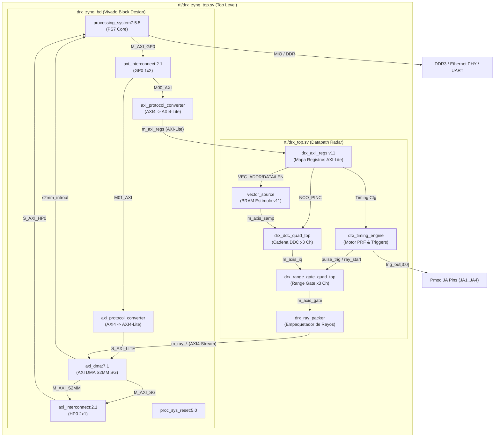

# Diseño de la PL (Block Design, IPs y Conexiones)

La Lógica Programable (PL) alberga la cadena completa de procesamiento digital de señales (DSP) del radar y la infraestructura de aceleración de transferencia de datos. Esta página describe la organización del Block Design generado por script, la jerarquía de código SystemVerilog en `rtl/`, y las restricciones físicas de pines.

## Diagrama del Block Design de la PL

El Block Design `drx_zynq_bd` (generado automáticamente mediante `tcl/gen_zynq_bd.tcl`) encapsula el bloque del procesador PS7 y las IP de interconexión AXI de Xilinx. El datapath propio de radar vive en `rtl/drx_top.sv`, instanciado junto al wrapper del BD dentro de `rtl/drx_zynq_top.sv`.

### Explicación del flujo en el Block Design

1. **Ruta de Control (PS7 → AXI GP0):**
   - El puerto `M_AXI_GP0` del PS7 se conecta a un `axi_interconnect` con dos salidas maestras.
   - La salida `M00_AXI` se convierte a AXI4-Lite mediante `axi_protocol_converter` y sale del BD como la interfaz `m_axi_regs` hacia el módulo `drx_axil_regs` dentro de `drx_top.sv`.
   - La salida `M01_AXI` se convierte a AXI4-Lite y alimenta el puerto `S_AXI_LITE` del core `axi_dma`.

2. **Ruta de Datos de Rayos (PL → PS7 AXI HP0):**
   - `drx_ray_packer` emite un AXI4-Stream de 32 bits de ancho (pareja I/Q de 16 bits) con señal `TLAST` marcando el final del rayo.
   - La interfaz ingresa al puerto `S_AXIS_S2MM` del AXI DMA.
   - El AXI DMA realiza transferencias Scatter-Gather hacia la memoria DDR3 mediante el puerto `S_AXI_HP0` a través de `axi_ic_hp`.

3. **Manejo del Ancho de Descriptor DMA (`c_sg_length_width = 23`):**
   - En `tcl/gen_zynq_bd.tcl`, el parámetro `c_sg_length_width` se fijó en 23 bits (8 MiB - 1). Un rayo completo en modo fino (3689 bins × 3 canales × 4 B + 16 B cabecera = 44,284 B) supera el límite de 16 KB por defecto. Con 23 bits, **un rayo entero cabe en un solo descriptor de memoria**, simplificando el procesamiento en firmware.

---

## Módulos HDL en `rtl/`

El datapath en `rtl/drx_top.sv` incluye las siguientes IP:

| Módulo SystemVerilog | Función Principal | Archivo Fuente |
|---|---|---|
| `vector_source.sv` | Generador de estímulo con BRAM de 8192 muestras por canal, cargables vía AXI-Lite en tiempo de ejecución (mapa v11). | `rtl/vector_source.sv` |
| `drx_ddc_quad_top.sv` | Instancia `N_CH` canales de la cadena DDC (NCO, mezclador, decimador CIC, filtros FIR halfband y módulos de saturación/redondeo). | `rtl/drx_ddc_quad_top.sv` |
| `drx_range_gate_quad_top.sv` | Agrupación de celdas de distancia (*range gating*) usando memorias BRAM en configuración ping-pong. | `rtl/drx_range_gate_quad_top.sv` |
| `drx_ray_packer.sv` | Formatea el rayo agregando una cabecera en banda de 4 palabras (`0x52415931` magic, `trig_count`, `ray_index`, banderas) y genera la señal `TLAST`. | `rtl/drx_ray_packer.sv` |
| `drx_timing_engine.sv` | Generador de base de tiempos radar (motor de PRF, secuenciador de lotes de 2 PRF, y 4 salidas de disparo ajustables en retardo y ancho). | `rtl/drx_timing_engine.sv` |
| `drx_axil_regs.sv` | Banco de registros AXI-Lite v11 que expone el control y estado de todo el sistema hacia el procesador. | `rtl/drx_axil_regs.sv` |

---

## Relojes y Restricciones de Pines (XDC)

### Relojes del Sistema
- **`FCLK0` (62.5 MHz):** Generado por la PLL del PS7, actúa como reloj principal de todo el fabric de la PL. Las restricciones de tiempo en `tcl/xdc/zedboard_zynq.xdc` derivan automáticamente del modelo del PS7.

### Pines de E/S Físicos de la ZedBoard
El archivo `tcl/xdc/zedboard_zynq.xdc` asigna los pines del puerto Pmod JA para monitoreo externo con osciloscopio o analizador lógico:

| Señal RTL | Pin Físico ZedBoard | Ubicación / Puerto | Descripción |
|---|---|---|---|
| `led_heartbeat` | `T22` | LED `LD0` | Destello de presencia de reloj y vida de la PL. |
| `debug_probe` | `Y11` | Pmod JA - Pin 1 | Sonda de depuración combinacional. |
| `trig_out[0]` | `AA11` | Pmod JA - Pin 2 | Disparo de transmisión radar (Pulse Trig). |
| `trig_out[1]` | `Y10` | Pmod JA - Pin 3 | Disparo auxiliar 1. |
| `trig_out[2]` | `AA9` | Pmod JA - Pin 4 | Disparo auxiliar 2. |
| `trig_out[3]` | `AB11` | Pmod JA - Pin 7 | Disparo auxiliar 3. |

!!! note "Pines MIO dedicados del PS7"
    Los pines de Ethernet (RGMII/MDIO), DDR3 y UART no requieren asignaciones en el archivo `.xdc`. Xilinx Vivado los rutea automáticamente mediante el *bonding* físico del integrado Zynq-7000 según el preset aplicado en `tcl/gen_zynq_bd.tcl`.
