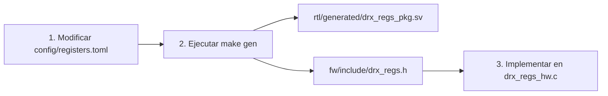

# Guía para Añadir una Tarea o Periférico Nuevo

Esta guía paso a paso está dirigida a ingenieros de software embebido que necesiten extender las funcionalidades del firmware de LAMULA DRx, ya sea agregando un nuevo registro de control en la PL, instanciando una nueva tarea en FreeRTOS o conectando un nuevo periférico por interrupción.

---

## 1. Guía para Agregar un Nuevo Registro AXI-Lite

Para mantener la disciplina de "fuente única de verdad", **nunca edites a mano** `fw/include/drx_regs.h` ni `rtl/generated/drx_regs_pkg.sv`.



### Paso 1: Modificar `config/registers.toml`
Agrega el nuevo registro especificando su offset, modo de acceso y descripción:
```toml
[[register]]
name = "MI_PERIFERICO_CTRL"
offset = "0x68"
access = "RW"
description = "Control del nuevo periférico de usuario."
```

### Paso 2: Regenerar el Código
Ejecuta el generador automático desde la raíz del repositorio:
```bash
make gen
make check
```
Esto actualizará los archivos generados y verificará que las cabeceras coincidan.

### Paso 3: Agregar las Funciones en el Driver C
Declara e implementa las funciones de lectura/escritura en `fw/include/drx_regs_hw.h` y `fw/src/app/drx_regs_hw.c`:
```c
/* fw/include/drx_regs_hw.h */
uint32_t DrxReg_ReadMiPeriferico(void);
void DrxReg_WriteMiPeriferico(uint32_t val);

/* fw/src/app/drx_regs_hw.c */
uint32_t DrxReg_ReadMiPeriferico(void) {
    return DrxReg_Read(DRX_REG_MI_PERIFERICO_CTRL_OFFSET);
}
void DrxReg_WriteMiPeriferico(uint32_t val) {
    DrxReg_Write(DRX_REG_MI_PERIFERICO_CTRL_OFFSET, val);
}
```

---

## 2. Guía para Agregar una Nueva Tarea en FreeRTOS

### Paso 1: Definir los Parámetros de la Tarea
Crea el archivo de cabecera `fw/include/mi_tarea.h`:
```c
#ifndef MI_TAREA_H
#define MI_TAREA_H

#define MI_TAREA_STACK_WORDS 1024
#define MI_TAREA_PRIORITY    2

void MiTarea_Create(void);

#endif
```

### Paso 2: Implementar la Función de Tarea
Crea el archivo de código fuente `fw/src/app/mi_tarea.c`:
```c
#include "mi_tarea.h"
#include "FreeRTOS.h"
#include "task.h"
#include "xil_printf.h"

static void mi_tarea_func(void *pvParameters)
{
    (void)pvParameters;
    xil_printf("MiTarea: iniciada con éxito\r\n");

    for (;;) {
        /* Lógica de la tarea */
        vTaskDelay(pdMS_TO_TICKS(1000));
    }
}

void MiTarea_Create(void)
{
    xTaskCreate(mi_tarea_func, "mi_tarea", MI_TAREA_STACK_WORDS, NULL,
                MI_TAREA_PRIORITY, NULL);
}
```

### Paso 3: Registrar la Tarea en `main.c` y en el Script de Vitis
1. Incluye `mi_tarea.h` e invoca `MiTarea_Create()` dentro de `main_thread()` en `fw/src/app/main.c`.
2. **Importante:** Agrega los nuevos archivos `.c` y `.h` en los bucles de copiado de `tcl/gen_bsp.tcl`:
   ```tcl
   # En tcl/gen_bsp.tcl
   foreach f { ... mi_tarea.c } { file copy -force ... }
   foreach f { ... mi_tarea.h } { file copy -force ... }
   ```

---

## 3. Guía para Conectar una Nueva Interrupción PL → PS

Si agregas un módulo en la PL que genera una señal de interrupción hacia el procesador:

1. **Block Design (`tcl/gen_zynq_bd.tcl`):** Conecta la señal de interrupción al puerto `ps7/IRQ_F2P`. Si hay múltiples interrupciones, utiliza el bloque `xlconcat` para agruparlas.
2. **Identificador de Interrupción (`xparameters.h`):** Al compilar el BSP con XSCT, Vitis asignará una macro `XPAR_FABRIC_<NOMBRE>_INTR`.
3. **Registro del Manejador en C:**
   ```c
   /* Instalar la rutina de interrupción en el GIC */
   xPortInstallInterruptHandler(MI_PERIFERICO_IRQ_ID, mi_isr, NULL);
   vPortEnableInterrupt(MI_PERIFERICO_IRQ_ID);
   ```
4. **Implementación de la ISR:**
   Recuerda utilizar únicamente primitivas seguras para interrupciones (`FromISR`) y solicitar cambio de contexto si despiertas a una tarea de mayor prioridad.
