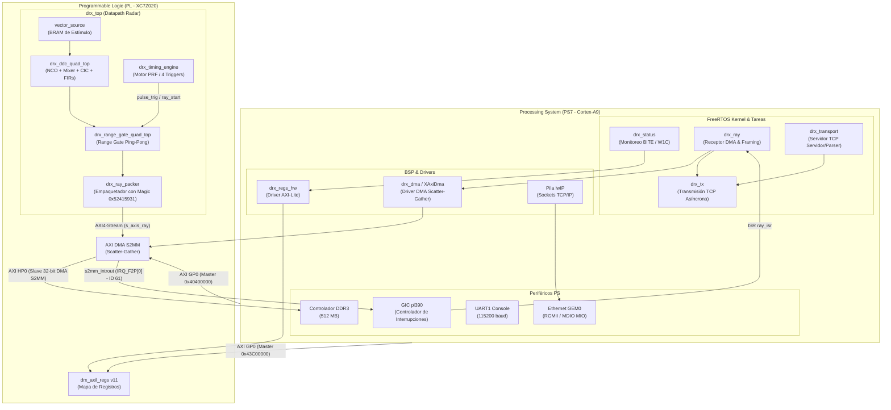

# Visión General del Firmware

El firmware de LAMULA DRx es la capa de software embebido en tiempo real que se ejecuta sobre el procesador Zynq-7000 (Cortex-A9) de la [ZedBoard](plataforma-hw-sw.md). Su objetivo principal es gobernar el procesamiento digital de señales realizado en la [Lógica Programable (PL)](diseno-pl.md), empaquetar las series de tiempo I/Q de radar junto con sus metadatos en forma de rayos, y servirlas al procesador de señales (DSP) a través de una interfaz [Ethernet 1GbE](plataforma-hw-sw.md) bajo el contrato DRx↔DSP.

El sistema opera sobre [FreeRTOS](configuracion-freertos.md) y la pila de red lwIP, garantizando tiempos de respuesta deterministas ante las interrupciones del hardware y procesando hasta 231 rayos por segundo de forma continua.

## Arquitectura General del Sistema

La siguiente figura muestra la división de responsabilidades entre el Processing System ([PS](plataforma-hw-sw.md)), la Lógica Programable ([PL](diseno-pl.md)) y los perfiles de interconexión [AXI](mapa-registros.md):

### Puntos clave de la arquitectura

1. **Separación de Control y Datos (GP0 vs HP0):**
   - El plano de control utiliza el puerto **AXI GP0** (General Purpose) para acceder por AXI-Lite al mapa de registros de `drx_top` (`0x43C00000`) y a los registros del AXI DMA (`0x40400000`).
   - El plano de datos de alta velocidad utiliza el puerto **AXI HP0** (High Performance) mediante DMA S2MM (Stream-to-Memory-Mapped), permitiendo a la PL escribir directamente los rayos en la memoria DDR3 del PS sin intervención de la CPU durante la transferencia.

2. **Procesamiento Asíncrono Diferido por Interrupción:**
   - Cuando la PL completa un rayo en DDR3, el AXI DMA aserta la línea de interrupción `s2mm_introut` hacia el [GIC](glosario.md) (IRQ 61). La rutina [ISR](glosario.md) (`ray_isr`) únicamente reconoce la interrupción y libera un semáforo binario para despertar a la tarea de prioridad alta `drx_ray`.

3. **Arquitectura Multi-Tarea en FreeRTOS:**
   - La tarea `drx_ray` procesa el rayo recibido en DDR3, valida su cabecera y lo entrega a la cola de salida.
   - La tarea `drx_transport` mantiene el socket TCP escuchando comandos del DSP y actualiza los parámetros en tiempo de ejecución.
   - La tarea `drx_status` realiza sondeos periódicos cada 1000 ms sobre los registros con flags de error autolimpiables (Write-1-to-Clear).

!!! tip "Principio de diseño: Aislamiento del enlace Ethernet"
    En `fw/src/app/main.c`, la inicialización del motor de timing, las autopruebas de hardware y el arranque de `drx_status` ocurren **antes** de inicializar la pila de red `lwip_init()`. Esto garantiza que los diagnósticos y el bring-up de la PL sobre la consola UART sean operativos incluso si el cable de red está desconectado.

## Estructura de Módulos del Firmware

El firmware está organizado en la carpeta `fw/` del repositorio:

- `fw/include/`: Cabeceras que definen las interfaces del firmware (`drx_regs_hw.h`, `drx_ray.h`, `drx_transport.h`, `drx_status_task.h`, etc.).
- `fw/src/app/`: Código fuente de las tareas y drivers embebidos (`main.c`, `drx_ray.c`, `drx_transport.c`, `drx_status_task.c`, `drx_regs_hw.c`, `drx_dma.c`).
- `fw/src/`: Autopruebas unitarias ejecutable en entorno standalone/host.
- `fw/tests/`: Pruebas de integración en Python para validar tramas y modelos.

---

## Preguntas frecuentes de desarrollo

- **¿Dónde toco el código para agregar un registro nuevo?**
  No edites `fw/include/drx_regs.h` directamente. Modifica `config/registers.toml` y ejecuta `make gen` para regenerar los paquetes RTL y firmware. Luego implementa las funciones de acceso en `fw/src/app/drx_regs_hw.c`.
- **¿Dónde ajusto el tamaño de los buffers de rayos?**
  Los parámetros de buffers de memoria están centralizados en `fw/include/drx_ray.h` (`DRX_RAY_BUFFERS`, `DRX_RAY_BUF_WORDS`).
