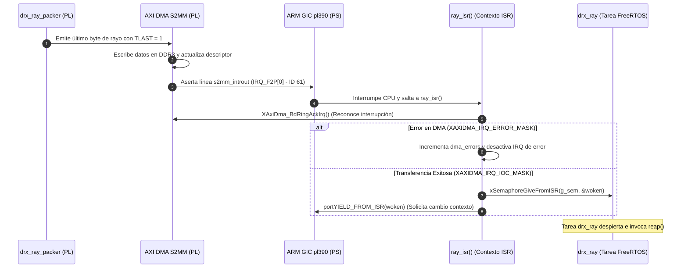
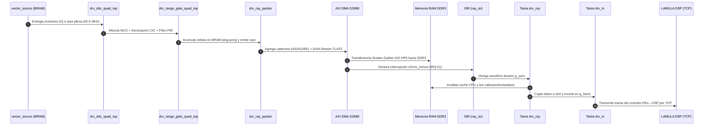

# Rutinas de Interrupción (ISR) y GIC

El sistema LAMULA DRx responde en tiempo real a los eventos producidos por la Lógica Programable mediante el controlador de interrupciones del ARM Cortex-A9 ([GIC pl390](plataforma-hw-sw.md#1-processing-system-ps)). Esta página detalla la configuración del GIC, el funcionamiento de la rutina de servicio de interrupción (`ray_isr`) y los flujos de secuencia extremo a extremo.

## Interrupción del AXI DMA (IRQ 61 / IRQ_F2P[0])

El AXI DMA S2MM genera una interrupción de fin de transferencia cada vez que un rayo de radar se escribe completamente en la memoria RAM DDR3.

### Diagrama del Flujo de Interrupción S2MM



---

## Detalle del Código de la ISR (`ray_isr` en `drx_ray.c`)

La rutina de interrupción está optimizada para ejecutarse en la menor cantidad de ciclos de reloj posible:

```c
/* fw/src/app/drx_ray.c */
static void ray_isr(void *ref)
{
    (void)ref;

    XAxiDma_BdRing *ring = XAxiDma_GetRxRing(g_dma);
    u32 irq = XAxiDma_BdRingGetIrq(ring);

    /* 1. Reconocer la interrupción en el controlador del DMA */
    XAxiDma_BdRingAckIrq(ring, irq);

    /* 2. Manejo de errores de hardware */
    if ((irq & XAXIDMA_IRQ_ERROR_MASK) != 0u) {
        g_status.dma_errors++;
        /* Se desactiva la IRQ de error para evitar tormentas de interrupciones
         * si la condición de error en el bus AXI persiste */
        XAxiDma_BdRingIntDisable(ring, XAXIDMA_IRQ_ERROR_MASK);
    }

    /* 3. Manejo de fin de transferencia (Interrupt On Complete) */
    if ((irq & (XAXIDMA_IRQ_IOC_MASK | XAXIDMA_IRQ_DELAY_MASK)) != 0u) {
        BaseType_t woken = pdFALSE;
        xSemaphoreGiveFromISR(g_sem, &woken);
        portYIELD_FROM_ISR(woken);
    }
}
```

### Registro e Instalación de la ISR
Durante la llamada a `DrxRay_Init()`, la interrupción se registra en el vector de FreeRTOS/BSP mediante:
```c
xPortInstallInterruptHandler(DRX_RAY_IRQ_ID, ray_isr, NULL);
vPortEnableInterrupt(DRX_RAY_IRQ_ID);
XAxiDma_BdRingIntEnable(ring, XAXIDMA_IRQ_ALL_MASK);
```
Donde `DRX_RAY_IRQ_ID` equivale a la macro `XPAR_FABRIC_DMA_S2MM_INTROUT_INTR` (definida como **61** en `xparameters.h`).

---

## Flujo Extremo a Extremo (Caso de Uso Principal)

El siguiente diagrama ilustra la trayectoria completa de una muestra desde la BRAM de estímulo en la PL hasta su transmisión por red hacia el procesador de señales DSP:



---

## Admoniciones sobre Manejo de Interrupciones

!!! warning "Cuidado con tormentas de interrupción en fallos AXI"
    Si ocurre un error en el bus AXI HP0 (por ejemplo, intento de acceso a una dirección no mapeada), el AXI DMA mantiene la línea de interrupción asertada. Reconocer la interrupción sin desactivar la máscara de error provocará reingresos infinitos a la ISR, congelando la CPU. Por esta razón, `ray_isr()` ejecuta `XAxiDma_BdRingIntDisable(ring, XAXIDMA_IRQ_ERROR_MASK)` si detecta un error.

!!! tip "Invalidador de caché en frontera DMA"
    Dado que la CPU lee los datos que el DMA acaba de escribir en DDR3, la invalidez de la caché debe aplicarse **dos veces**: en `submit_buffer()` antes de entregar el descriptor al DMA, y en `deliver()` inmediatamente antes de analizar la cabecera. Esto evita que el mecanismo de *prefetch* especulativo de la arquitectura ARM lea datos obsoletos.
