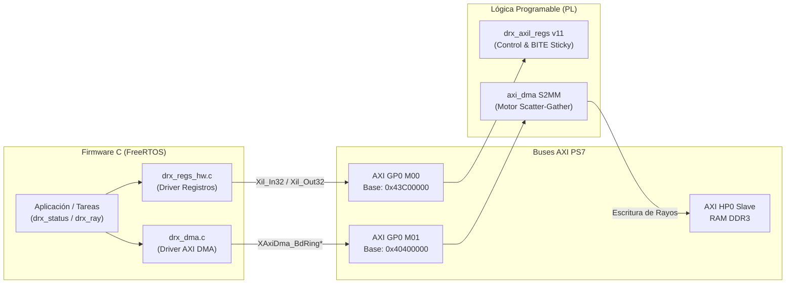

# Interfaz Hardware/Software y Mapa de Registros

La interfaz entre el software en FreeRTOS y los bloques de lógica programable se realiza principalmente a través del mapa de registros AXI-Lite **v11** expuesto por la IP `drx_axil_regs` en `rtl/drx_top.sv`.

## Diagrama de la Frontera HW/SW

La figura a continuación ilustra cómo las funciones del driver en C interactúan con los buses físicos AXI y las direcciones de memoria asignadas en el BSP:



---

## Tabla del Mapa de Registros AXI-Lite (v11)

Dirección Base en memoria del PS: **`XPAR_M_AXI_REGS_BASEADDR` = `0x43C00000`**.
Ancho de datos: 32 bits. Alineamiento a palabra de 4 bytes.

| Offset | Nombre | Acceso | Bits Usados | Descripción y Semántica |
|---|---|---|---|---|
| `0x00` | `VERSION` | RO | `[31:0]` | Versión del mapa de registros (actualmente **11**). Permite al firmware verificar compatibilidad con el bitstream cargado antes de operar. |
| `0x04` | `CTRL` | RW | `[0]`, `[2]` | **Bit 0:** `mode_coarse` (0 = fino, 1 = grueso).<br/>**Bit 1:** Reservado (lee 0).<br/>**Bit 2:** `vector_load` (1 = congela lector de BRAM de estímulo para permitir carga vía `VEC_DATA`). |
| `0x08` | `STATUS` | RO + W1C | `[N_CH-1:0]` | **Bit c:** Flag *sticky* de `overrun` del canal `c` de range gate. Se limpia escribiendo un 1 en el bit correspondiente (Write-1-to-Clear). |
| `0x0C` | `OVERFLOW` | RO + W1C | `[N_CH-1:0]` | **Bit c:** Flag *sticky* de desbordamiento por saturación en la cadena DDC del canal `c`. Limpieza W1C. |
| `0x10` | `TIMING_CTRL` | RW | `[1:0]` | **Bit 0:** `enable` del secuenciador de lotes PRF.<br/>**Bit 1:** `timing_paced` (0 = el motor cuenta ciclos de reloj, 1 = cuenta avances de muestra). |
| `0x14` | `TIMING_STATUS` | RO + W1C | `[2:0]` | **Bit 0:** `radial_done` *sticky*.<br/>**Bits 2:1:** `config_invalid` para lote alto y bajo según regla D-09 (W1C). |
| `0x18` | `PRF_DIV_LOW` | RW | `[31:0]` | División de PRF para el lote bajo (ciclos de `FS_HZ` por PRI). |
| `0x1C` | `PRF_DIV_HIGH` | RW | `[31:0]` | División de PRF para el lote alto (ciclos de `FS_HZ` por PRI). |
| `0x20` | `PULSE_WIDTH` | RW | `[15:0]`, `[31:16]` | **[15:0]:** Ancho de pulso lote bajo (ciclos).<br/>**[31:16]:** Ancho de pulso lote alto (ciclos). |
| `0x24` | `N_PULSES` | RW | `[15:0]`, `[31:16]` | **[15:0]:** Cantidad de pulsos en lote bajo.<br/>**[31:16]:** Cantidad de pulsos en lote alto por radial. |
| `0x28`–`0x34` | `TRIG_DELAY_0..3` | RW | `[31:0]` | Retardo del pulso de disparo (en ciclos de `FS_HZ`) para cada uno de los 4 canales de disparo. |
| `0x38`–`0x44` | `TRIG_WIDTH_0..3` | RW | `[31:0]` | Ancho del pulso de disparo (en ciclos de `FS_HZ`, debe ser $\ge 1$) para cada uno de los 4 canales. |
| `0x48` | `BINS_LOW` | RW | `[31:0]` | Cantidad de celdas de distancia (*bins*) para el lote bajo. |
| `0x4C` | `BINS_HIGH` | RW | `[31:0]` | Cantidad de celdas de distancia (*bins*) para el lote alto. |
| `0x50` | `GATE_TRUNCATED` | RO + W1C | `[N_CH-1:0]` | **Bit c:** Flag *sticky* que indica si un rayo del canal `c` fue truncado antes de completarse. W1C. |
| `0x54` | `TRIG_COUNT` | RO | `[31:0]` | Contador libre acumulativo de impulsos de disparo de la PL. No se borra al leer. |
| `0x58` | `NCO_PINC` | RW | `[31:0]` | Palabra de incremento de fase para el NCO del DDC. Dispara re-sintonía en el mezclador. |
| `0x5C` | `VEC_ADDR` | RW | `[12:0]`, `[18:16]` | **[12:0]:** Puntero de dirección dentro del banco BRAM.<br/>**[18:16]:** Banco objetivo (0..2 por canal, 7 = difusión a todos). |
| `0x60` | `VEC_DATA` | RW | `[15:0]` | Muestra de 16 bits enviada a BRAM. Escribir autoincrementa `VEC_ADDR`. |
| `0x64` | `VEC_LEN` | RW | `[12:0]` | Longitud del bucle de reproducción del vector de estímulo (por defecto 4000 muestras). |

---

## Driver de Bajo Nivel (`fw/src/app/drx_regs_hw.c`)

El acceso al mapa de registros desde C se abstrae en las funciones `DrxReg_Read` y `DrxReg_Write`:

```c
/* fw/src/app/drx_regs_hw.c */
#include "drx_regs_hw.h"
#include "xil_io.h"
#include "xparameters.h"

uint32_t DrxReg_Read(uint32_t offset)
{
    return Xil_In32(XPAR_M_AXI_REGS_BASEADDR + offset);
}

void DrxReg_Write(uint32_t offset, uint32_t value)
{
    Xil_Out32(XPAR_M_AXI_REGS_BASEADDR + offset, value);
}
```

!!! warning "Precaución con los registros Sticky (W1C)"
    Los registros `STATUS`, `OVERFLOW`, `TIMING_STATUS` y `GATE_TRUNCATED` utilizan la semántica **Write-1-to-Clear**. Escribir un bit en `1` borra esa bandera en la PL. Para evitar limpiar eventos no deseados por accidente, nunca realices operaciones de lectura-modificación-escritura (`OR` de bits) sobre estos registros; escribe únicamente una máscara con los bits específicos que deseas limpiar.
