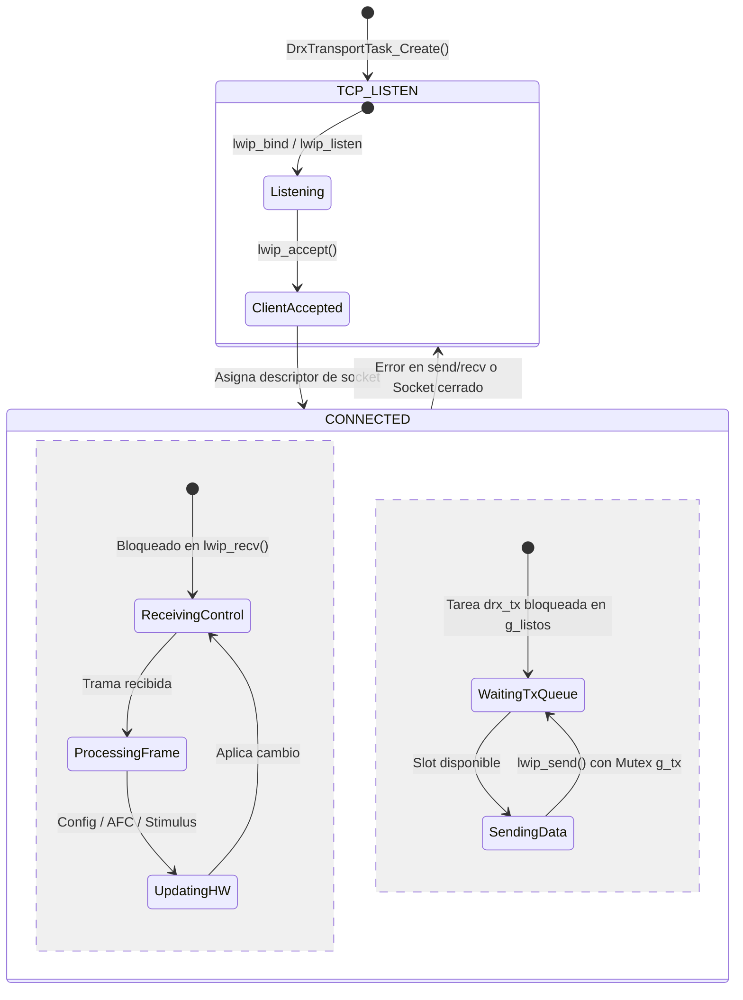

# Módulos y Drivers de Firmware

Esta página ofrece una referencia completa de los módulos de software y *drivers* que componen la aplicación `drx_app.elf` en `fw/src/app/`.

## Resumen de Módulos C

| Módulo / Driver | Archivos (`.h` / `.c`) | Función y Responsabilidad |
|---|---|---|
| **Driver de Registros HW** | `drx_regs_hw.h`<br/>`drx_regs_hw.c` | Acceso AXI-Lite de bajo nivel sobre `XPAR_M_AXI_REGS_BASEADDR` (`0x43C00000`). Abstrae operaciones R/W, borrado de registros *sticky* (W1C) y configuración del motor de timing. |
| **Driver AXI DMA** | `drx_dma.h`<br/>`drx_dma.c` | Inicialización de la IP `axi_dma` (`0x40400000`) y verificación del modo Scatter-Gather S2MM. |
| **Receptor de Rayos** | `drx_ray.h`<br/>`drx_ray.c` | Gestión del anillo circular de 16 descriptores DMA en DDR3, manejo de la ISR `ray_isr`, validación de cabecera en banda (`0x52415931`), congelamiento por JTAG (`DrxRay_Freeze`) y entrega a la tarea de salida. |
| **Monitoreo de Estado** | `drx_status_task.h`<br/>`drx_status_task.c` | Tarea periódica de sondeo (cada 1000 ms). Acumula eventos BITE (`STATUS`, `OVERFLOW`, `GATE_TRUNCATED`, `TIMING_STATUS`) y formatea tramas `status`. |
| **Configuración de Timing** | `drx_timing_cfg.h`<br/>`drx_timing_cfg.c` | Secuencia de arranque síncrona del motor de timing. Configura valores de PRF, anchos de pulso y retardos válidos bajo D-09 antes de iniciar el secuenciador. |
| **Carga de Estímulo** | `drx_stimulus.h`<br/>`drx_stimulus.c` | Control de la ventana AXI-Lite v11 para carga de muestras en la BRAM de `vector_source`. Permite seleccionar vectores del catálogo en caliente. |
| **Plano de Control & Boot** | `drx_control_boot.h`<br/>`drx_control_boot.c` | Implementa el reconocedor de comandos del contrato DRx↔DSP y ejecuta autopruebas con tramas sintéticas durante el arranque. |
| **Aplicación AFC** | `drx_afc_app.h`<br/>`drx_afc_app.c` | Recibe correcciones de frecuencia del DSP, calcula la nueva palabra `NCO_PINC` y la aplica en la frontera entre dos rayos (`DrxAfcApp_OnRay`). |
| **Transporte TCP** | `drx_transport.h`<br/>`drx_transport.c` | Mantiene el servidor TCP en el puerto 5000, parsea comandos del DSP, administra las colas de transmisión asíncrona (`g_libres`/`g_listos`) y ejecuta `DrxTxTask`. |

---

## Ciclo de Vida del Transporte TCP (`drx_transport`)

El módulo de transporte administra la conexión punto a punto contra el procesador de señales DSP:



---

## Detalle de Módulos Principales

### 1. Driver de Registros HW (`drx_regs_hw.c`)
Proporciona funciones específicas para manipular los registros de la PL de forma segura:
- `DrxReg_ReadNcoPinc()` / `DrxReg_WriteNcoPinc(uint32_t pinc)`: Escribe la nueva palabra de fase del NCO e incrementa el pulso de configuración en `drx_ddc_top`.
- `DrxReg_VecSetAddr()`, `DrxReg_VecWrite()`: Permite cargar el buffer de BRAM de 8192 muestras por difusión (`bank = 7`) o por canal individual.

### 2. Receptor de Rayos (`drx_ray.c`)
Administra los buffers en DDR3 y verifica la integridad de los rayos recibidos:
- **Punteros de Memoria:** `g_buf[16][DRX_RAY_BUF_WORDS]` alineados a 64 bytes (línea de caché del Cortex-A9).
- **Validación de Cabecera:**
  ```c
  static bool parse_header(const uint32_t *words, DrxRayHeader *out) {
      if (words[0] != DRX_RAY_MAGIC) return false; // 0x52415931 ("RAY1")
      out->trig_count = words[1];
      out->ray_index = words[2];
      uint32_t flags = words[3];
      out->bin_count = (uint16_t)(flags & 0xFFFFu);
      out->n_ch = (uint8_t)((flags >> 24) & 0xFFu);
      return true;
  }
  ```

### 3. Sintonización Automática de Frecuencia (`drx_afc_app.c`)
El módulo AFC aplica el cambio de frecuencia en la frontera exacta entre rayos para no corromper la fase interna de un rayo en curso:
```c
void DrxAfcApp_OnRay(uint32_t ray_index) {
    if (g_pending_afc && ray_index >= g_apply_ray_index) {
        DrxReg_WriteNcoPinc(g_pending_pinc);
        g_pending_afc = false;
    }
}
```
