# Arquitectura de Tareas FreeRTOS

El firmware de LAMULA DRx se organiza en una arquitectura de múltiples tareas sobre el núcleo de **FreeRTOS v10.4**. Cada tarea tiene asignada una responsabilidad específica, un tamaño de pila (*stack*) ajustado y una prioridad explícita para garantizar la atención inmediata de los eventos del radar.

## Tabla Resumen de Tareas FreeRTOS

| Nombre Tarea | Función C / Archivo | Prioridad | Stack (Palabras) | Tipo de Activación | Descripción Principal |
|---|---|---|---|---|---|
| **`main_thrd`** | `main_thread`<br/>(`main.c`) | 1 (`DEFAULT_THREAD_PRIO`) | 1024 | Efímera (Arranque) | Inicializa hardware (Timing, Estímulo, Rayos, AFC), arranca tareas y se auto-elimina (`vTaskDelete`). |
| **`NW_THRD`** | `network_thread`<br/>(`main.c`) | 1 (`DEFAULT_THREAD_PRIO`) | 1024 | Efímera (Red) | Configura la interfaz de red Ethernet (`192.168.1.10`), lanza `xemacif_input_thread` y crea `drx_transport`. |
| **`xemacif_input`**| `xemacif_input_thread`<br/>(lwIP BSP) | 1 (`DEFAULT_THREAD_PRIO`) | 1024 | Por Evento (Rx EMAC) | Procesa las tramas de red Ethernet de bajo nivel desde el driver de Xilinx (`xemacps`). |
| **`drx_status`** | `DrxStatusTask`<br/>(`drx_status_task.c`) | 2 (`DRX_STATUS_TASK_PRIO`) | 1024 | Periódica (1000 ms) | Lee y limpia (W1C) los registros de diagnóstico *sticky* AXI-Lite, acumula contadores BITE y formatea mensajes `status`. |
| **`drx_ray`** | `ray_task`<br/>(`drx_ray.c`) | 2 (`DRX_RAY_TASK_PRIORITY`) | 2048 | Por Evento (`g_sem`) | Despierta con la ISR del AXI DMA S2MM, vacía el anillo de descriptores, valida la cabecera en banda y entrega el rayo. |
| **`drx_transport`**| `DrxTransportTask`<br/>(`drx_transport.c`) | 2 (`DRX_TRANSPORT_PRIO`) | 2048 | Bloqueante (`recv`) | Gestiona el socket servidor TCP en el puerto 5000, acepta conexiones del DSP y parsea tramas de control entrantes. |
| **`drx_tx`** | `DrxTxTask`<br/>(`drx_transport.c`) | 2 (`DRX_TRANSPORT_PRIO`) | 2048 | Por Evento (`g_listos`) | Transmite de forma asíncrona sobre el socket TCP las tramas de rayos y estado preparadas en la cola de salida. |

---

## Jerarquía de Prioridades y Modelo de Planificación

FreeRTOS opera en modo preemptevolutivo (`configUSE_PREEMPTION = 1`) con un tick de reloj de 1000 Hz (`configTICK_RATE_HZ = 1000`).

```mermaid
gantt
    title Cronograma Ilustrativo de Ejecución de Tareas en FreeRTOS
    dateFormat  SS
    axisFormat %S s

    section ISR DMA
    Interrupción s2mm_introut : active, isr1, 00, 01
    section Prioridad 2
    drx_ray (Procesamiento Rayo) : crit, ray1, after isr1, 03s
    drx_tx (Transmisión TCP)    : active, tx1, after ray1, 02s
    drx_status (Sondeo BITE 1s) : status1, 06, 08s
    section Prioridad 1
    xemacif_input / lwIP IP     : net1, 08, 10s
```



### Principios de asignación de prioridades

1. **Atención Prioritaria al Dato Radar (Prioridad 2):**
   - La tarea `drx_ray` tiene la prioridad más alta del sistema junto con `drx_tx`, `drx_transport` y `drx_status`. Al ser liberada por la ISR mediante el semáforo `g_sem`, desaloja de inmediato a las tareas de menor prioridad para evitar desbordamiento (*overrun*) en el anillo de descriptores de la PL.
2. **Ceder la CPU Eficientemente:**
   - La tarea `drx_ray` únicamente se ejecuta cuando hay rayos listos en el anillo; el resto del tiempo se mantiene bloqueada en `xSemaphoreTake(g_sem, portMAX_DELAY)`.
   - La tarea `drx_transport` se mantiene bloqueada en llamadas a `lwip_recv()` esperando comandos de control.
   - La tarea `drx_tx` permanece bloqueada en la cola de FreeRTOS `xQueueReceive(g_listos, ..., portMAX_DELAY)`.

---

## Descripción Detallada de Tareas Clave

### Tarea de Recepción de Rayos (`drx_ray`)
- **Archivo:** `fw/src/app/drx_ray.c`.
- **Función:** `static void ray_task(void *arg)`.
- **Bucle principal:**
  ```c
  for (;;) {
      if (xSemaphoreTake(g_sem, portMAX_DELAY) == pdTRUE) {
          reap();
      }
  }
  ```
- **Responsabilidad:** La función `reap()` consulta al AXI DMA mediante `XAxiDma_BdRingFromHw()`. Para cada descriptor completado, invalida la línea de caché de la CPU, invoca a `deliver()` para validar las 4 palabras de cabecera en banda (magic `0x52415931`, `trig_count`, `ray_index`), invoca el callback `g_sink` (que copia los datos hacia los slots de transmisión) y re-encola el descriptor en la PL mediante `submit_buffer()`.

### Tarea de Monitoreo de Estado (`drx_status`)
- **Archivo:** `fw/src/app/drx_status_task.c`.
- **Función:** `static void DrxStatusTask(void *pvParameters)`.
- **Periodicidad:** Se activa cada 1000 ms ejecutando `vTaskDelay(pdMS_TO_TICKS(1000))`.
- **Responsabilidad:** Lee los registros `STATUS`, `OVERFLOW`, `GATE_TRUNCATED` y `TIMING_STATUS`. Debido a que la lectura de estos registros borra las banderas en la PL (semántica W1C), esta tarea es el **único consumidor autorizado** en todo el firmware para leerlos y limpiarlos. Acumula los eventos BITE en la estructura `DrxStatusInputs` y envía periódicamente el mensaje `status` al DSP.

### Tarea de Transporte Servidor TCP (`drx_transport`)
- **Archivo:** `fw/src/app/drx_transport.c`.
- **Función:** `static void DrxTransportTask(void *pvParameters)`.
- **Responsabilidad:** Abre un socket en el puerto `DRX_DSP_TCP_PORT` (5000) y ejecuta `lwip_accept()`. Al recibir una conexión, se bloquea en `lwip_recv()` y pasa el *stream* de bytes al parser `drx_contract_io`.
