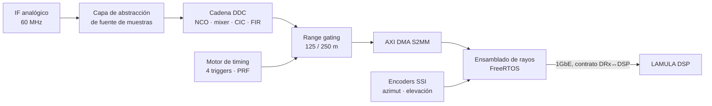

# LAMULA DRx — Receptor digital FPGA

LAMULA DRx es el receptor digital del sistema LAMULA: digitaliza el IF del radar, hace la
conversión a banda base y el diezmado en la lógica programable, ensambla los rayos con sus
metadatos en el procesador y los entrega al DSP por 1GbE. Su **única interfaz externa es
DRx↔DSP**; el DRx nunca habla directamente con el RCP ni con ORPG.

## Estado del proyecto

El hardware objetivo — **Zynq UltraScale+ ZU9 con dos mezzanines VadaTech FMC213** — todavía no
está comprado. La plataforma de desarrollo primaria mientras eso no exista es una **Digilent
ZedBoard (XC7Z020-CLG484-1)**. Este repositorio implementa el firmware contra la ZedBoard con
disciplina de portabilidad explícita, para que el salto a la ZU9 sea un cambio de parámetro y un
re-cierre de temporización, no una reescritura.

- **Plan vigente de trabajo:** [Fases Z0–Z5](implementacion/fases.md) — 28 semanas.
- **Lo que esta plataforma no puede cubrir:** [Frontera y cobertura](plataforma/zedboard.md) — en
  particular JESD204B, el árbol de clocking y SYSREF, que **no reciben ninguna mitigación** en
  ZedBoard.
- **Deuda de portabilidad viva:** [Registro delta ZedBoard → ZU9](portabilidad/registro-delta.md).

!!! warning "Validado en ZedBoard no es validado"
    El riesgo número uno del proyecto — bring-up de JESD204B y clocking — es hardware-bound. No se
    reduce con trabajo de software y sigue abierto durante todo el tiempo que la ZU9 no exista.
    Ningún hito se declara sin leer el registro delta.

## Por dónde empezar

| Si eres… | Lee primero |
|---|---|
| **Alguien que quiere entender lo que hay construido** | El **[tutorial](tutorial/index.md)** — siete páginas en orden, con las gráficas y los números que produce el repositorio hoy |
| Desarrollador que se incorpora | [Contexto](alcance/contexto.md) → [Decisiones congeladas](alcance/decisiones.md) → [Fases](implementacion/fases.md) → [Tutorial](tutorial/index.md) |
| Especialista de dominio / QA | [Plan de testing](pruebas/plan-testing.md) → [Modelo dorado](pruebas/modelo-dorado.md) → [Pendientes](alcance/pendientes.md) |
| Responsable de compra de hardware | [Pendientes](alcance/pendientes.md) → [Frontera y cobertura](plataforma/zedboard.md) |
| Auditor del alcance original | [Project Plan ZU9](referencia/project-plan-zu9.md) |

## Proyectos hermanos

- **LAMULA DSP** — procesador de señal en Rust; convierte las series de tiempo I/Q en momentos
  meteorológicos. Es el único par de red del DRx y el copropietario del contrato DRx↔DSP.
- **LAMULA RCP** — Radar Control Processor y MMI del operador. La configuración se origina aquí y
  llega al DRx relevada por el DSP.

## Origen de estos documentos

Las páginas de este sitio derivan de dos documentos que se conservan íntegros en
[Referencia](referencia/plan-zedboard.md): el plan de implementación y testing sobre ZedBoard, y el
project plan original de 34 semanas para la ZU9. Cuando una página de este sitio y un documento de
referencia discrepan, **manda esta página** y la discrepancia es un bug del sitio que hay que
cerrar.
