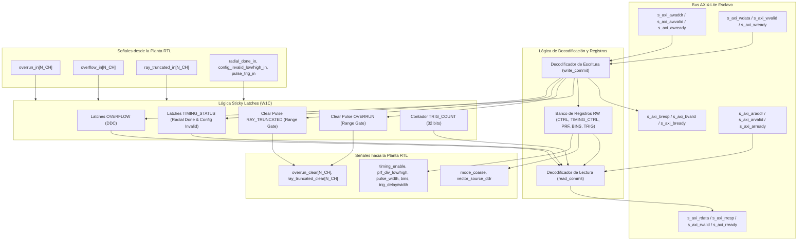

# IP Core: `drx_axil_regs` (Controlador AXI4-Lite & Mapa de Registros)

## 1. Resumen

La IP **`drx_axil_regs`** es el controlador esclavo AXI4-Lite que expone la interfaz de software y control del procesador digital de señal (PL) hacia el Processor System (PS / FreeRTOS).

Proporciona un mapa de registros unificado para la configuración en tiempo de ejecución de la cadena DDC, la selección de fuente de muestras, la programación del motor de timing y la lectura de contadores y diagnósticos BITE. Además, administra la lógica de enganche (*sticky latches*) con borrado mediante escritura de uno (**Write-1-to-Clear / W1C**) para capturar eventos breves como sobre-rangos (*overflow*), saturaciones (*overrun*), truncamientos de rayos (*ray_truncated*) e inconsistencias de configuración (D-09).

---

## 2. Características Principales

- **Cumplimiento Estricto AXI4-Lite:** Interfaz esclava simplificada sin soporte de bursts ni transacciones fuera de orden, garantizando respuesta constante `OKAY` (2'b00).
- **Lógica Sticky con Write-1-to-Clear (W1C):** Captura de eventos transitorios de 1 solo ciclo (como `radial_done` o `overflow`) reteniendo el valor en '1' hasta que el software escribe explícitamente un '1' en ese bit para limpiarlo.
- **Prioridad Set-sobre-Clear Concurrente:** Si ocurre un nuevo evento de error en el mismo ciclo de reloj en que el software ejecuta la limpieza W1C, el hardware mantiene la bandera de error activada, evitando pérdidas silenciosas de diagnósticos.
- **Exposición Unificada de Parámetros:** Interconectado directamente con `drx_timing_engine`, `vector_source`, `drx_ddc_quad_top` y `drx_range_gate_quad_top`.
- **Contador Libre de Disparos (`TRIG_COUNT` - Z4.1):** Contador monótono de 32 bits alimentado directamente por `pulse_trig`.

---

## 3. Diagrama de Bloques Interno

---

## 4. Mapa de Registros AXI4-Lite

La fuente de verdad del mapa de registros reside en `config/registers.toml` y genera automáticamente la cabecera C `fw/include/drx_regs.h` y el paquete SystemVerilog `rtl/generated/drx_regs_pkg.sv`.

Ancho de dirección: `REGS_ADDR_WIDTH = 8` bits (espacio de direcciones `0x00` a `0xFF`).

| Offset | Nombre del Registro | Permiso | Valor Reset | Descripción / Campos |
| :---: | :--- | :---: | :---: | :--- |
| `0x00` | `VERSION` | RO | `0x00000008` | Versión actual del mapa de registros AXI-Lite (v8). |
| `0x04` | `CTRL` | RW | `0x00000000` | **Registro de Control Principal:** - `bit [0]`: `mode_coarse` (`0` = Fino, `1` = Grueso). - `bit [1]`: `vector_source_ddr` (`0` = BRAM-Loop, `1` = Throttled DDR). - `bits [31:2]`: Reservados (`0`). |
| `0x08` | `STATUS` | RO / W1C | `0x00000000` | **Estado de Overrun del Range Gate por Canal:** - `bits [N_CH-1:0]`: Muestra `overrun` del canal $c$. Escribir `1` en el bit $c$ emite un pulso en `overrun_clear[c]`. |
| `0x0C` | `GATE_TRUNCATED` | RO / W1C | `0x00000000` | **Estado de Rayo Truncado (BITE D-14):** - `bits [N_CH-1:0]`: Indicador sticky de descarte de rayo por llegada de `ray_start` desalineado. Escribir `1` limpia el bit correspondiente. |
| `0x10` | `TRIG_COUNT` | RO | `0x00000000` | Contador libre de 32 bits de pulsos de disparo `pulse_trig`. |
| `0x14` | `OVERFLOW` | RO / W1C | `0x00000000` | **Estado Sticky de Overflow del DDC:** - `bits [N_CH-1:0]`: Indicador de desbordamiento en la saturación final de las ramas $I/Q$ del DDC. Escribir `1` limpia el bit. |
| `0x18` | `TIMING_CTRL` | RW | `0x00000000` | **Control del Motor de Timing:** - `bit [0]`: `timing_enable` (`1` = Habilita `drx_timing_engine`). |
| `0x1C` | `TIMING_STATUS` | RO / W1C | `0x00000000` | **Estado del Motor de Timing:** - `bit [0]`: `radial_done` (Sticky, fin de radial). - `bit [1]`: `config_invalid_low` (Inconsistencia de config en lote bajo D-09). - `bit [2]`: `config_invalid_high` (Inconsistencia de config en lote alto D-09). |
| `0x20` | `PRF_DIV_LOW` | RW | `0x00000000` | Divisor de PRI en ciclos de reloj para el Lote Bajo. |
| `0x24` | `PRF_DIV_HIGH` | RW | `0x00000000` | Divisor de PRI en ciclos de reloj para el Lote Alto. |
| `0x28` | `PULSE_WIDTH` | RW | `0x00000000` | Ancho de compuerta TX: - `bits [15:0]`: `pulse_width_low`. - `bits [31:16]`: `pulse_width_high`. |
| `0x2C` | `N_PULSES` | RW | `0x00000000` | Cantidad de pulsos por lote: - `bits [15:0]`: `n_pulses_low`. - `bits [31:16]`: `n_pulses_high`. |
| `0x30` | `BINS_LOW` | RW | `0x00000000` | Conteo de celdas/bins de rango para el Lote Bajo (D-15). |
| `0x34` | `BINS_HIGH` | RW | `0x00000000` | Conteo de celdas/bins de rango para el Lote Alto (D-15). |
| `0x38` | `TRIG_DELAY_0` | RW | `0x00000000` | Retardo del Trigger 0 en ciclos de reloj tras `pulse_trig`. |
| `0x3C` | `TRIG_DELAY_1` | RW | `0x00000000` | Retardo del Trigger 1 en ciclos de reloj. |
| `0x40` | `TRIG_DELAY_2` | RW | `0x00000000` | Retardo del Trigger 2 en ciclos de reloj. |
| `0x44` | `TRIG_DELAY_3` | RW | `0x00000000` | Retardo del Trigger 3 en ciclos de reloj. |
| `0x48` | `TRIG_WIDTH_0` | RW | `0x00000000` | Ancho del pulso del Trigger 0 en ciclos de reloj. |
| `0x4C` | `TRIG_WIDTH_1` | RW | `0x00000000` | Ancho del pulso del Trigger 1 en ciclos de reloj. |
| `0x50` | `TRIG_WIDTH_2` | RW | `0x00000000` | Ancho del pulso del Trigger 2 en ciclos de reloj. |
| `0x54` | `TRIG_WIDTH_3` | RW | `0x00000000` | Ancho del pulso del Trigger 3 en ciclos de reloj. |

---

## 5. Descripción de Interfaces y Señales

### 5.1. Puertos AXI4-Lite Esclavos

| Nombre de Puerto | Dirección | Ancho (bits) | Protocolo | Descripción |
| :--- | :--- | :--- | :--- | :--- |
| `s_axi_awaddr` | Entrada | `REGS_ADDR_WIDTH` (8) | AXI4-Lite | Dirección del canal de escritura. |
| `s_axi_awvalid` / `s_axi_awready` | Entrada / Salida | 1 | AXI4-Lite | Handshake del canal de dirección de escritura. |
| `s_axi_wdata` | Entrada | 32 | AXI4-Lite | Datos a escribir (los bytes strobings `s_axi_wstrb` se asumen completos). |
| `s_axi_wvalid` / `s_axi_wready` | Entrada / Salida | 1 | AXI4-Lite | Handshake del canal de datos de escritura. |
| `s_axi_bresp` / `s_axi_bvalid` / `s_axi_bready` | Salida / Salida / Entrada | 2 / 1 / 1 | AXI4-Lite | Respuesta de escritura (siempre devuelve `2'b00` - OKAY). |
| `s_axi_araddr` | Entrada | `REGS_ADDR_WIDTH` (8) | AXI4-Lite | Dirección del canal de lectura. |
| `s_axi_arvalid` / `s_axi_arready` | Entrada / Salida | 1 | AXI4-Lite | Handshake del canal de dirección de lectura. |
| `s_axi_rdata` / `s_axi_rresp` | Salida / Salida | 32 / 2 | AXI4-Lite | Datos leídos y respuesta del canal de lectura. |
| `s_axi_rvalid` / `s_axi_rready` | Salida / Entrada | 1 / 1 | AXI4-Lite | Handshake del canal de datos de lectura. |
