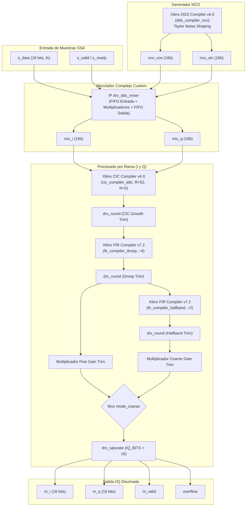
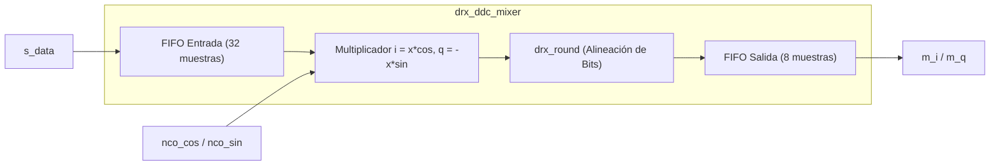

# IP Core: Cadena DDC (`drx_ddc_top`, `drx_ddc_quad_top` & `drx_ddc_mixer`)

## 1. Resumen

La IP **DDC (Digital Down Converter)** es el núcleo de procesado de señal en banda base del receptor digital. Transforma la señal de FI real digitalizada $x[n]$ entregada por la fuente SSA en un flujo de muestras complejas quadrature $I[n] + j Q[n]$ diezmadas, filtradas y compensadas.

Sigue la estrategia **Xilinx-IP-first (D-06)**: utiliza cores IPs estándar de Xilinx (DDS Compiler v6.0, CIC Compiler v4.0, FIR Compiler v7.2) configurados a **precisión completa**, mientras que el mezclador complejo (`drx_ddc_mixer`), la compensación de ganancia fina y el empaquetado de redondeo y saturación simétrica (`drx_round` / `drx_saturate`) están implementados en RTL customizado.

Se ofrecen dos niveles de jerarquía:
- **`drx_ddc_top`:** Cadena DDC monolítica de **un solo canal**.
- **`drx_ddc_quad_top`:** Envolvente multicanal que instanciar $N_{CH}$ canales paralelos e independientes de `drx_ddc_top`.

---

## 2. Características Principales

- **Conversión Descendente Quadrature Compleja:** Mezcla digital mediante NCO sintético de fase fija con corrección de ruido Taylor (`Taylor_Series_Corrected`).
- **Mezclador Elástico con Latencia Determinista:** El mezclador `drx_ddc_mixer` incorpora FIFOs de entrada y salida para desacoplar el arranque del NCO y la contrapresión aguas abajo sin perder alineación de fase.
- **Etapas de Filtrado y Diezmado:**
  - **Fase CIC (Cascaded Integrator-Comb):** Diezmado por $R_1 = 52$ con $N = 5$ etapas y retardo diferencial $M = 1$.
  - **Fase FIR Droop:** Compensación de la respuesta sinc del CIC y diezmado por $R_2 = 4$ con filtro simétrico.
  - **Fase FIR Semibanda (Modo Grueso):** Diezmado adicional opcional por $\times 2$ (filtro semibanda de 23 taps).
- **Conmutación de Modo Dinámico (Fino / Grueso):** Conmutación combinacional por rayo de la rama de procesamiento:
  - **Modo Fino (`mode_coarse = 0`):** Factor de diezmado total $R_{total} = 52 \times 4 = 208$.
  - **Modo Grueso (`mode_coarse = 1`):** Factor de diezmado total $R_{total} = 52 \times 4 \times 2 = 416$.
- **Ajuste de Ganancia Fina (Gain Trim):** Multiplicadores constantes por rama (`FINE_GAIN_COEFF` y `COARSE_GAIN_COEFF`) para compensar el exceso de atenuación del truncamiento a potencia de dos.
- **Saturación con Reporte de Overflow:** Detección combinacional de desbordamiento en la saturación final a `IQ_BITS` (16 bits).

---

## 3. Diagrama de Bloques Interno (`drx_ddc_top`)

---

## 4. Descripción de Interfaces y Señales

### 4.1. Puertos del Módulo `drx_ddc_top`

| Nombre de Puerto | Dirección | Ancho (bits) | Protocolo | Descripción |
| :--- | :--- | :--- | :--- | :--- |
| `clk` | Entrada | 1 | Clock | Reloj principal de procesado (`FS_HZ`). |
| `rst_n` | Entrada | 1 | Reset | Reset asíncrono global activo en bajo. |
| `s_valid` | Entrada | 1 | Handshake | Indicador de muestra de entrada válida. |
| `s_ready` | Salida | 1 | Handshake | Señal de disponibilidad para aceptar muestra de entrada. |
| `s_data` | Entrada | `SAMPLE_BITS` (16) | Datos con Signo | Muestra real digitalizada $x[n]$ en FI. |
| `s_last` | Entrada | 1 | Stream | Reservado / No utilizado en esta etapa. |
| `mode_coarse` | Entrada | 1 | Control | Selector de modo de diezmado: `0` = Fino ($\div 208$), `1` = Grueso ($\div 416$). |
| `m_valid` | Salida | 1 | Stream | Indicador de muestra complex $I/Q$ de salida válida. |
| `m_i` | Salida | `IQ_BITS` (16) | Datos con Signo | Componente en fase $I[n]$ recortada a 16 bits. |
| `m_q` | Salida | `IQ_BITS` (16) | Datos con Signo | Componente en cuadratura $Q[n]$ recortada a 16 bits. |
| `overflow` | Salida | 1 | Flag Nivel | Pulso/nivel de desbordamiento de la etapa final de saturación. |

---

## 5. Sub-Módulo `drx_ddc_mixer`: Mezclador Complejo NCO

El módulo `drx_ddc_mixer` realiza el despaletizado complejo:
$$i[n] = x[n] \cdot \cos(\omega_0 n)$$
$$q[n] = x[n] \cdot \sin(\omega_0 n)$$

Para garantizar la sincronización exacta entre la fase del NCO y las muestras de entrada:

1. **FIFO de Entrada (`in_mem`):** Absorbe el retraso de inicialización y latencia del DDS Compiler tras soltar la línea de reset.
2. **Emparejamiento Estricto (`pair_en`):** Solo consume una muestra de la FIFO de entrada si existe un paso de fase válido del NCO (`nco_valid`). El NCO no utiliza `tready` para evitar latencias no deterministas de FIFOs internas del core Xilinx.
3. **FIFO de Salida (`out_mem_i`, `out_mem_q`):** Absorbe la contrapresión que el filtro CIC pueda imponer sobre la etapa de mezcla.

---

## 6. Ajuste de Ganancia y Redondeo de Punto Fijo

Cada etapa de filtrado opera a **precisión completa** en las IPs de Xilinx. La pérdida de escala introducida al dividir por la potencia de dos superior mediante desplazamiento de bits (`drx_round`) se ajusta exactamente mediante los coeficientes de ganancia fija generados por `tools/gen_params.py`:

| Parámetro / Coeficiente | Valor Típico / Fórmulas | Descripción |
| :--- | :--- | :--- |
| `CIC_GROWTH_BITS` | Generado por Modelo | Bits recortados a la salida del filtro CIC. |
| `FIR_GROWTH_BITS` | Generado por Modelo | Bits recortados a la salida del filtro FIR Droop. |
| `HALFBAND_GROWTH_BITS` | Generado por Modelo | Bits recortados a la salida del filtro Semibanda. |
| `FINE_GAIN_COEFF` | `GAIN_TRIM_BITS` (18 bits) | Coeficiente multiplicativo para restaurar ganancia en modo fino. |
| `COARSE_GAIN_COEFF` | `GAIN_TRIM_BITS` (18 bits) | Coeficiente multiplicativo para restaurar ganancia en modo grueso. |

Tras el escalado de ganancia fina, la señal pasa por la unidad de saturación simétrica `drx_saturate`, la cual recorta el rango dinámico a $[-2^{15}, 2^{15}-1]$ y activa la señal `overflow` si la magnitud supera el fondo de escala.
