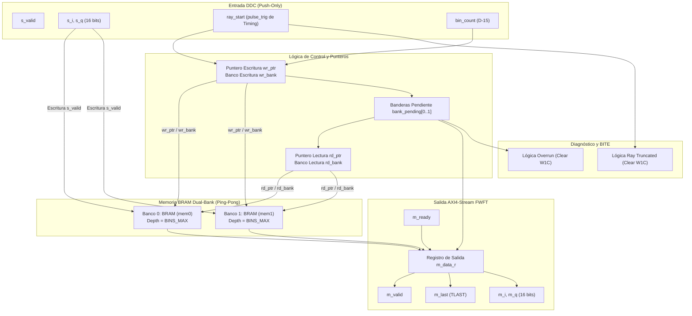
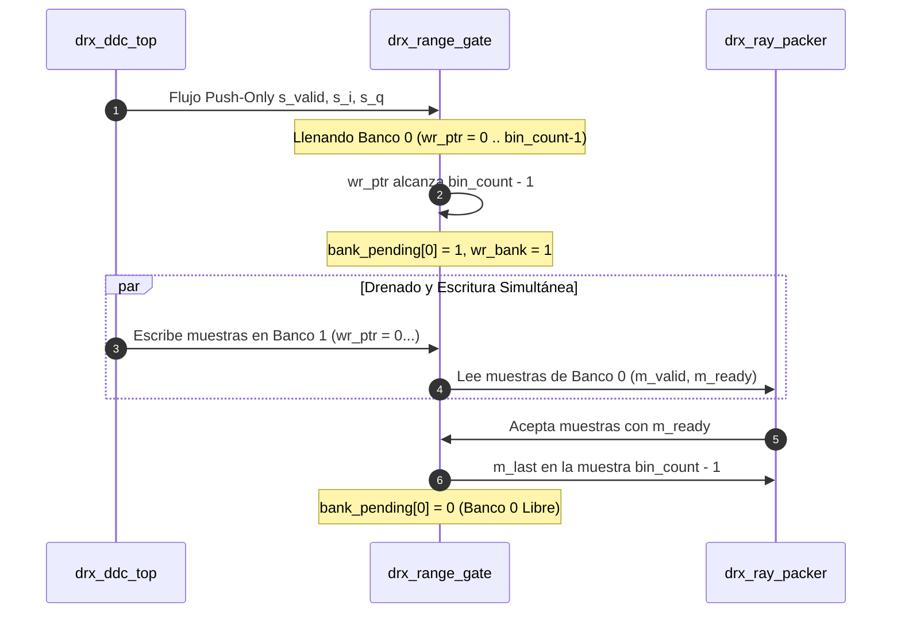

# IP Core: `drx_range_gate` (Gating de Rango y Memoria Ping-Pong)

## 1. Resumen

La IP **`drx_range_gate`** realiza el delimitado (framing) del flujo continuo de datos cuadrantes $I/Q$ provenientes del DDC en rayos de longitud arbitraria $N_{bins} = \text{bin\_count}$ muestras. Introduce la frontera fundamental entre la entrada *push-only* del DDC (que no admite contrapresión) y la salida **AXI4-Stream real con protocolo handshake completo (`m_ready`)** hacia las etapas posteriores.

Para lograr este desacoplo sin perder ninguna muestra entrante, implementa una **arquitectura de BRAM en doble banco (Ping-Pong)**: mientras un banco se llena de forma obligatoria a la tasa del DDC, el banco opuesto (que contiene el rayo capturado anterior) se drena hacia el empaquetador al ritmo que imponga el consumidor AXI4-Stream.

Incluye mecanismos de diagnóstico de tiempo real duro (BITE):
- **`overrun`:** Se activa si un banco no se ha vaciado por completo antes de que el banco opuesto termine de llenarse.
- **`ray_truncated` (D-14):** Se activa si la señal de resincronización de disparo `ray_start` llega cuando un banco tiene datos a medio llenar, descartando el rayo incompleto.

---

## 2. Características Principales

- **Desacoplo de Contrapresión (*Backpressure Decoupling*):** Interfaz de entrada sin handshake (*push-only*) y salida AXI4-Stream estandarizada con `m_valid`, `m_ready` y `m_last` (TLAST en la muestra $\text{bin\_count}-1$).
- **Arquitectura Ping-Pong Dual-Bank:** Dos bancos de BRAM simples (*simple-dual-port*) de capacidad máxima `BINS_MAX` (`BINS_MODE_FINE`).
- **Resincronización Dinámica con Timing (`ray_start` - D-14):** Reinicio síncrono del puntero de escritura `wr_ptr` con cada pulso `pulse_trig` del motor de timing, evitando la acumulación de muestras de tiempo muerto entre ecoradiogramas.
- **Detección de Rayo Truncado (BITE - D-14):** Registro BITE dedicado con limpieza W1C (`clear_truncated`) que notifica si un PRI mal configurado o un disparo fuera de fase recortó un rayo antes de completarlo.
- **Salida Registrada FWFT (First-Word Fall-Through):** Estructura de salida registrada síncrona optimizada para sintetizarse en bloques BRAM nativos de Xilinx sin lógica combinacional en el camino crítico.

---

## 3. Diagrama de Bloques Interno

---

## 4. Descripción de Interfaces y Señales

### 4.1. Puertos del Módulo `drx_range_gate`

| Nombre de Puerto | Dirección | Ancho (bits) | Protocolo | Descripción |
| :--- | :--- | :--- | :--- | :--- |
| `clk` | Entrada | 1 | Clock | Reloj del sistema (`FS_HZ`). |
| `rst_n` | Entrada | 1 | Reset | Reset asíncrono activo en bajo. |
| `s_valid` | Entrada | 1 | Push Stream | Muestra $I/Q$ de entrada válida proveniente del DDC. |
| `s_i`, `s_q` | Entrada | `IQ_BITS` (16) | Datos con Signo | Componentes cuadráticas de muestra $I/Q$. |
| `bin_count` | Entrada | 32 | Configuración | Cantidad de bins/muestras esperadas por rayo (D-15). |
| `m_valid` | Salida | 1 | AXI4-Stream | Indicador de muestra de salida válida. |
| `m_ready` | Entrada | 1 | AXI4-Stream | Señal de aceptación de datos desde el consumidor (`drx_ray_packer`). |
| `m_i`, `m_q` | Salida | `IQ_BITS` (16) | AXI4-Stream | Componentes $I/Q$ del rayo hacia la etapa de empaquetado. |
| `m_last` | Salida | 1 | AXI4-Stream | Marcador TLAST en la última muestra del rayo ($\text{bin\_count}-1$). |
| `ray_start` | Entrada | 1 | Pulso | Pulso de resincronización de disparo (conectado a `pulse_trig`). |
| `clear` | Entrada | 1 | Pulso W1C | Limpieza de la bandera sticky `overrun` desde AXI-Lite. |
| `overrun` | Salida | 1 | Flag Sticky | Indicador BITE de pérdida/sobrescritura de rayo por falta de drena. |
| `clear_truncated` | Entrada | 1 | Pulso W1C | Limpieza de la bandera sticky `ray_truncated` desde AXI-Lite. |
| `ray_truncated` | Salida | 1 | Flag Sticky | Indicador BITE de truncamiento de rayo por llegada de `ray_start` a medio llenar. |

---

## 5. Parámetros de Configuración (Generics)

| Parámetro | Tipo | Valor por Defecto | Descripción |
| :--- | :--- | :--- | :--- |
| `BINS_MAX` | `integer` | `BINS_MODE_FINE` | Techo de profundidad de cada uno de los dos bancos BRAM. |
| `BinsBits` | `integer` | `32` | Ancho de bits del puerto `bin_count`. |

---

## 6. Operación del Doble Banco Ping-Pong

### 6.1. Ciclo de Conmutación de Bancos

1. **Escritura Continuada:** Las muestras entrantes se escriben secuencialmente en el banco activo de escritura (`wr_bank`, p. ej., Banco 0) incrementando `wr_ptr`.
2. **Cierre de Rayo por Conteo Natural:** Cuando `wr_ptr == bin_count - 1`:
   - El Banco 0 se marca como pendiente de lectura (`bank_pending[0] = 1`).
   - El puntero `wr_ptr` se reinicia a `0` y `wr_bank` se conmuta al Banco 1.
3. **Resincronización por Trigger (`ray_start` - D-14):** Si la señal `ray_start` se activa:
   - Se fuerza `wr_ptr <= 0`.
   - Si el banco en curso tenía muestras escritas no completadas en ese exacto ciclo, se marca la bandera BITE `ray_truncated <= 1` y ese fragmento se descarta sin marcarlo como pendiente.

