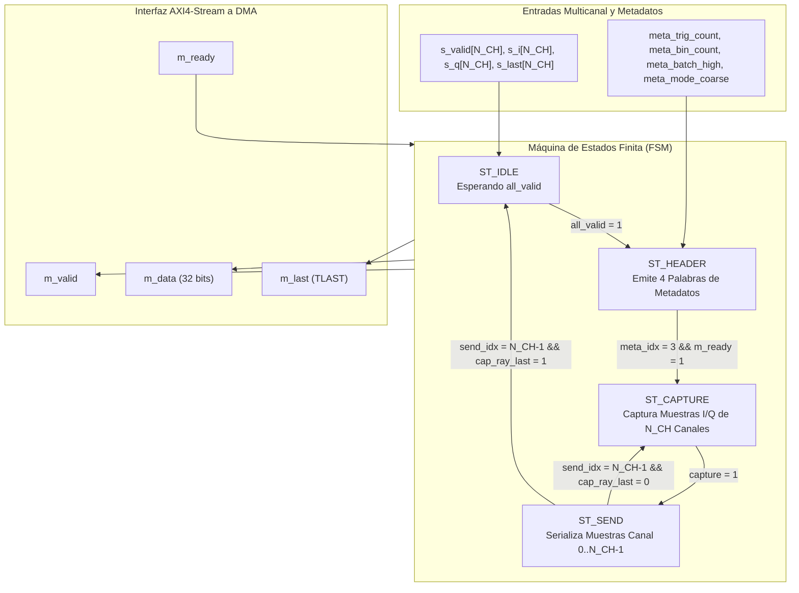

# IP Core: `drx_ray_packer` (Empaquetador de Rayos y Cabecera en Banda)

## 1. Resumen

La IP **`drx_ray_packer`** es el módulo final de serialización y empaquetado del procesador de señal PL antes de entregar los rayos de radar a la memoria DDR a través del canal AXI DMA S2MM.

Recibe los $N_{CH}$ flujos AXI4-Stream independientes provenientes de la etapa `drx_range_gate_quad_top` y realiza dos funciones críticas:

1. **Inserción de Cabecera en Banda (In-Band Header - Z4.4):** Antepone una cabecera de metadatos de **4 palabras de 32 bits** al principio de los datos de cada rayo. Esto permite al software (FreeRTOS) procesar con precisión determinista el número de disparo (`trig_count`), índice de rayo (`ray_index`), lote activo (`batch_high`) y modo DDC (`mode_coarse`) sin sufrir latencias ni carreras de interrupción.
2. **Serialización Multicanal Intercalada:** Convierte las muestras paralelas de $N_{CH}$ canales en una palabra de salida de **32 bits** (`BeatBits = 2 * IQ_BITS`), emitiendo secuencialmente el par $I/Q$ del Canal 0, Canal 1, ..., Canal $N_{CH}-1$ por cada bin de rango. Esto evita desperdiciar ancho de banda en buses AXI DMA de 64 o 128 bits.

---

## 2. Características Principales

- **Cabecera en Banda Autocontenida (Z4.4):** Antepone una palabra mágica identificadora (`0x52590001` "RY v1"), contador de disparos de 32 bits, contador de rayos emitidos de 32 bits y flags del sistema a cada rayo.
- **Sincronización Multicanal por Bloque:** Espera a que los $N_{CH}$ canales tengan muestras válidas simultáneamente (`all_valid`) antes de avanzar, reteniendo los registros FWFT del range-gate de manera segura.
- **Formato AXI DMA Amigable:** Genera un bus AXI4-Stream estándar de 32 bits con señal `m_last` (TLAST) alineada en el último beat de datos del rayo para el cierre automático del descriptor de dispersión-recolección (*Scatter-Gather*).
- **Contador Monótono de Rayos Emitidos:** Incrementa `ray_index` únicamente al completar con éxito la emisión de un rayo completo, facilitando la detección de pérdidas de rayos en recepción.

---

## 3. Diagrama de Bloques Interno y Maquina de Estados (FSM)



---

## 4. Estructura de la Cabecera en Banda (Metadatos - Z4.4)

Cada rayo emitido por la IP `drx_ray_packer` hacia el AXI DMA comienza con **4 beats de metadatos de 32 bits** (`MetaBeats = 4`), seguidos inmediatamente por los $N_{bins} \times N_{CH}$ beats de muestras $I/Q$:

| Beat | Offset | Nombre del Campo | Ancho (bits) | Descripción |
| :---: | :---: | :--- | :---: | :--- |
| **0** | `0x00` | `RayMagic` | 32 | Palabra mágica identificadora de cabecera: `0x52590001` ("RY\0\1"). |
| **1** | `0x04` | `ray_trig_count` | 32 | Contador libre de disparos de PRF al momento de capturar el rayo. |
| **2** | `0x08` | `ray_index` | 32 | Contador monótono de rayos emitidos exitosamente hacia DDR. |
| **3** | `0x0C` | `Flags & Bin Count` | 32 | Metadatos combinados:<br/>- `[31:24]`: Número de canales ($N_{CH} = 3$).<br/>- `[23:18]`: Reservado (`0`).<br/>- `[17]`: `ray_mode_coarse` (`0` = Fino, `1` = Grueso).<br/>- `[16]`: `ray_batch_high` (`0` = Lote Bajo, `1` = Lote Alto).<br/>- `[15:0]`: `ray_bin_count` (Cantidad de bins del rayo). |

---

## 5. Descripción de Interfaces y Señales

### 5.1. Puertos del Módulo `drx_ray_packer`

| Nombre de Puerto | Dirección | Ancho (bits) | Protocolo | Descripción |
| :--- | :--- | :--- | :--- | :--- |
| `clk` | Entrada | 1 | Clock | Reloj del sistema (`FS_HZ`). |
| `rst_n` | Entrada | 1 | Reset | Reset asíncrono activo en bajo. |
| `s_valid[N_CH]` | Entrada | $N_{CH}$ | AXI4-Stream | Indicadores de muestra válida por canal desde Range Gate. |
| `s_ready[N_CH]` | Salida | $N_{CH}$ | AXI4-Stream | Confirmación de lectura hacia Range Gate. |
| `s_i[N_CH]`, `s_q[N_CH]` | Entrada | $N_{CH} \times 16$ | Datos con Signo | Muestras $I/Q$ de 16 bits por canal. |
| `s_last[N_CH]` | Entrada | $N_{CH}$ | AXI4-Stream | Marcadores TLAST por canal desde Range Gate. |
| `meta_trig_count` | Entrada | 32 | Metadatos | Valor actual del contador de disparos desde `drx_axil_regs`. |
| `meta_bin_count` | Entrada | 16 | Metadatos | Cantidad de bins esperados en el rayo actual. |
| `meta_batch_high` | Entrada | 1 | Metadatos | Indicador de lote activo (`0` = Low, `1` = High). |
| `meta_mode_coarse` | Entrada | 1 | Metadatos | Indicador de modo DDC (`0` = Fino, `1` = Grueso). |
| `m_valid` | Salida | 1 | AXI4-Stream | Muestra o metadato de salida válido hacia AXI DMA. |
| `m_ready` | Entrada | 1 | AXI4-Stream | Señal de aceptación de datos desde el AXI DMA. |
| `m_data` | Salida | `2*IQ_BITS` (32) | AXI4-Stream | Bus empaquetado de 32 bits ($I/Q$ o metadato). |
| `m_last` | Salida | 1 | AXI4-Stream | Marcador TLAST emitido exclusivamente en la **última muestra de datos** del rayo. |

---

## 6. Diagrama de Tiempos del Empaquetado

```mermaid
gantt
    title Trama de Salida AXI4-Stream hacia AXI DMA (drx_ray_packer)
    dateFormat X
    axisFormat %s

    section Cabecera en Banda
    Beat 0: Magic (0x52590001)       :active, b0, 0, 1
    Beat 1: trig_count               :active, b1, 1, 2
    Beat 2: ray_index                :active, b2, 2, 3
    Beat 3: Flags / bin_count        :active, b3, 3, 4

    section Bin 0 (Muestras)
    Ch0 I/Q (32 bits)                :crit, c00, 4, 5
    Ch1 I/Q (32 bits)                :crit, c01, 5, 6
    Ch2 I/Q (32 bits)                :crit, c02, 6, 7

    section Bin N-1 (Último Bin)
    Ch0 I/Q                          :done, cn0, 7, 8
    Ch1 I/Q                          :done, cn1, 8, 9
    Ch2 I/Q (TLAST = 1)              :crit, cn2, 9, 10
```
