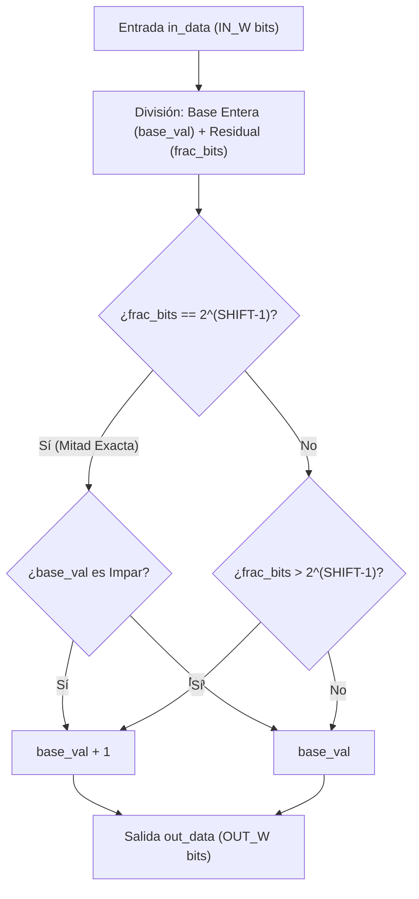
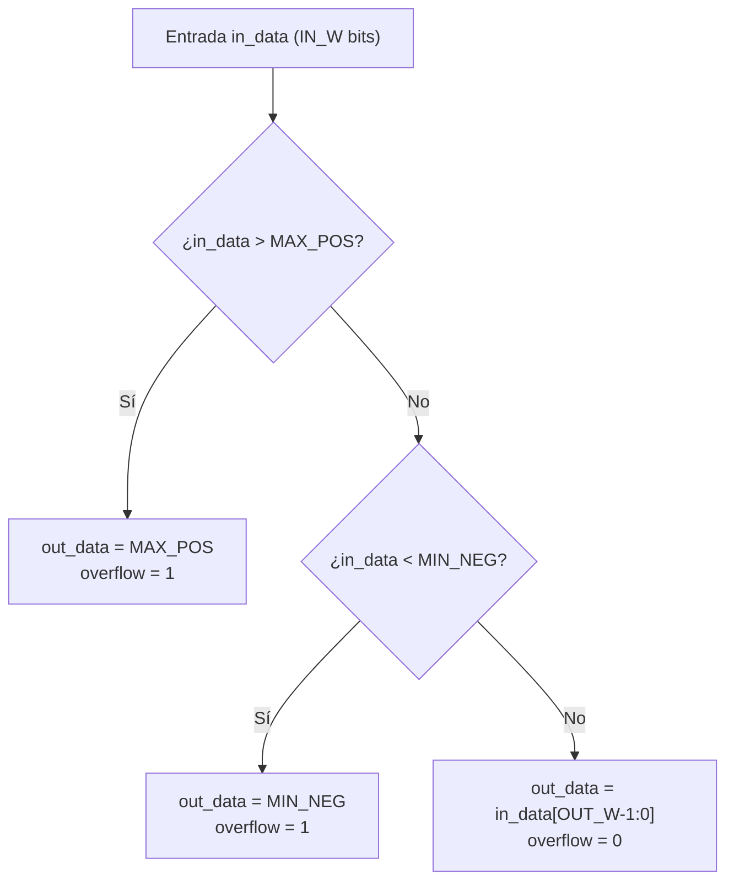

# IP Cores: Unidades Aritméticas (`drx_round` y `drx_saturate`)

## 1. Resumen

Las IP utilitarias **`drx_round`** y **`drx_saturate`** proporcionan el soporte de aritmética de punto fijo con signo de alta precisión utilizado a lo largo de toda la cadena DDC y recortadores de bits de la PL.

Para garantizar la reproductibilidad bit a bit exacta contra el modelo dorado en NumPy (`model/drx_model/fixed.py`), estos bloques implementan:
- **Redondeo Simétrico Convergente (*Half-to-Even* / *Banker's Rounding*):** Eliminación del sesgo estadístico de $DC$ inherente al redondeo por truncamiento directo o hacia el infinito.
- **Saturación Aritmética Simétrica:** Recorte de la magnitud de los datos al rango dinámico $[-2^{OUT\_W-1}, 2^{OUT\_W-1}-1]$ con generación síncrona/combinacional de la bandera de desbordamiento `overflow`.

---

## 2. IP `drx_round`: Redondeo Convergente Simétrico

### 2.1. Descripción de Funcionamiento

Dada una palabra de entrada de $IN\_W$ bits con signo `in_data` y un factor de desplazamiento a la derecha de $SHIFT$ bits, `drx_round` calcula el valor entero redondeado de $OUT\_W$ bits:

$$\text{out\_data} = \text{round}\left(\frac{\text{in\_data}}{2^{SHIFT}}\right)$$

El algoritmo evalúa la parte fraccionaria que se eliminará (los $SHIFT$ bits menos significativos):
1. **Remanente Exactamente 0.5 (Mitad de Escala):** Si los bits recortados equivalen exactamente a $2^{SHIFT-1}$ y los bits inferiores son 0, se redondea al entero **par** más cercano (inspeccionando el LSB del entero preservado).
2. **Remanente Mayor a 0.5:** Se suma 1 al entero.
3. **Remanente Menor a 0.5:** Se trunca el entero.

### 2.2. Tabla de Interfaces y Parámetros

| Nombre | Dirección | Ancho (bits) | Descripción |
| :--- | :--- | :--- | :--- |
| `in_data` | Entrada | `IN_W` | Palabra de entrada de punto fijo con signo de alta precisión. |
| `out_data` | Salida | `OUT_W` | Palabra redondeada de salida de menor ancho. |

| Parámetro | Tipo | Descripción |
| :--- | :--- | :--- |
| `IN_W` | `integer` | Ancho de bits de la palabra de entrada. |
| `SHIFT` | `integer` | Número de bits a desplazar a la derecha (bits fraccionarios a descartar). |
| `OUT_W` | `integer` | Ancho de bits de la palabra de salida resultante. |

---

## 3. IP `drx_saturate`: Saturación Aritmética Simétrica

### 3.1. Descripción de Funcionamiento

El módulo `drx_saturate` limita una palabra con signo de mayor ancho $IN\_W$ al rango representable por una palabra de $OUT\_W$ bits ($[-2^{OUT\_W-1}, 2^{OUT\_W-1}-1]$).

Lógica combinacional pura de evaluación:
- **Límite Superior ($+MAX$):** Si `in_data` $> 2^{OUT\_W-1} - 1$, se fija `out_data` en $2^{OUT\_W-1} - 1$ y se activa `overflow = 1`.
- **Límite Inferior ($-MIN$):** Si `in_data` $< -2^{OUT\_W-1}$, se fija `out_data` en $-2^{OUT\_W-1}$ y se activa `overflow = 1`.
- **Dentro de Rango:** Se asigna `out_data = in_data[OUT_W-1:0]` y `overflow = 0`.

### 3.2. Tabla de Interfaces y Parámetros

| Nombre | Dirección | Ancho (bits) | Descripción |
| :--- | :--- | :--- | :--- |
| `in_data` | Entrada | `IN_W` | Palabra de entrada con signo a verificar. |
| `out_data` | Salida | `OUT_W` | Palabra saturada ajustada al rango $[-2^{OUT\_W-1}, 2^{OUT\_W-1}-1]$. |
| `overflow` | Salida | 1 | Indicador combinacional de desbordamiento de rango. |

| Parámetro | Tipo | Descripción |
| :--- | :--- | :--- |
| `IN_W` | `integer` | Ancho de bits de la palabra de entrada. |
| `OUT_W` | `integer` | Ancho de bits deseado para la palabra de salida recortada. |
