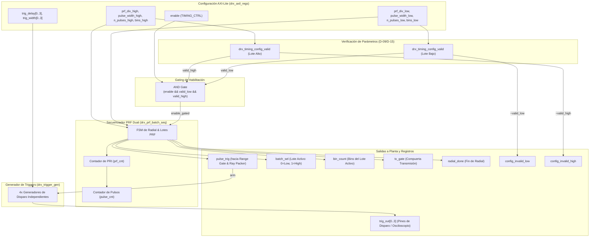

# IP Core: `drx_timing_engine` (Motor de Timing y Generador de Triggers)

## 1. Resumen

La IP **`drx_timing_engine`** es el corazón de sincronismo, temporización y generación de pulsos de disparo del radar. Es el responsable de orquestar el tiempo real duro en la lógica programable (PL) sin intervención del procesador durante el barrido de un radial.

Integra tres submódulos principales:
1. **`drx_prf_batch_seq`:** Secuenciador de lotes PRF duales (lote bajo y lote alto para entrelazado de frecuencia de repetición de pulso en patrones VCP de radar weather).
2. **`drx_trigger_gen`:** Generador de hasta $N_{TRIGGERS} = 4$ salidas de disparo independientes con retardo y ancho totalmente programables en ciclos de reloj.
3. **`drx_timing_config_valid` (D-09):** Unidad de verificación de consistencia en hardware que valida que los parámetros de disparo no violen las limitaciones físicas (ancho de pulso, cabida dentro del PRI, piso de rango no ambiguo y techo de memoria de bins).

---

## 2. Características Principales

- **Secuenciador PRF Dual (D-13):** Conmutación automática o programada entre un lote bajo (`prf_div_low`, `pulse_width_low`, `n_pulses_low`) y un lote alto (`prf_div_high`, `pulse_width_high`, `n_pulses_high`).
- **Sincronización Transmisor/Receptor:** Emisión del pulso `pulse_trig` para iniciar la captura de cada rayo en `drx_range_gate` y control de compuerta de transmisión `tx_gate`.
- **4 Salidas de Trigger Independientes:** Módulos de temporización `trig_out[0..3]` armados secuencialmente tras cada `pulse_trig` con contadores dedicados de retardo y ancho.
- **Validación Automática en Hardware (D-09 & D-15):** Detección instantánea de configuraciones inválidas. Congela la ejecución y activa banderas de estado `config_invalid_low` / `config_invalid_high` si:
  - El ancho de pulso supera el PRI.
  - El valor de `prf_div` viola el piso de rango no ambiguo del lote.
  - El conteo de bins `bin_count` excede la capacidad física de la BRAM (`BINS_MODE_FINE`).

---

## 3. Diagrama de Bloques Interno

---

## 4. Descripción de Interfaces y Señales

### 4.1. Entradas de Configuración y Control

| Nombre de Puerto | Dirección | Ancho (bits) | Protocolo | Descripción |
| :--- | :--- | :--- | :--- | :--- |
| `clk` | Entrada | 1 | Clock | Reloj del sistema (`FS_HZ`). |
| `rst_n` | Entrada | 1 | Reset | Reset asíncrono activo en bajo. |
| `enable` | Entrada | 1 | Control | Habilitación principal del motor de timing (`TIMING_CTRL.bit0`). |
| `prf_div_low` / `high` | Entrada | 32 | Valor Entero | Divisor del PRI en ciclos de reloj ($PRI = \text{prf\_div} / F_s$) para lotes Bajo y Alto. |
| `pulse_width_low` / `high` | Entrada | 16 | Valor Entero | Ancho de la compuerta de transmisión `tx_gate` en ciclos de reloj. |
| `n_pulses_low` / `high` | Entrada | 16 | Valor Entero | Cantidad de pulsos/disparos a emitir en el lote correspondiente antes de conmutar. |
| `bins_low` / `high` | Entrada | 32 | Valor Entero | Cantidad de celdas/bins de rango a procesar en el rayo del lote activo (D-15). |
| `trig_delay[4]` | Entrada | $4 \times 32$ | Valor Entero | Retardo de activación del trigger $i$ en ciclos de reloj tras `pulse_trig`. |
| `trig_width[4]` | Entrada | $4 \times 32$ | Valor Entero | Ancho de pulso activo en alto del trigger $i$ en ciclos de reloj. |

### 4.2. Salidas de Sincronismo y Estado

| Nombre de Puerto | Dirección | Ancho (bits) | Protocolo | Descripción |
| :--- | :--- | :--- | :--- | :--- |
| `pulse_trig` | Salida | 1 | Pulso (1 ciclo) | Disparo principal de inicio de pulso PRF. Inicia la captura del rayo en `drx_range_gate`. |
| `batch_sel` | Salida | 1 | Nivel | Lote activo: `0` = Lote Bajo, `1` = Lote Alto. |
| `pulse_width` | Salida | 16 | Nivel | Ancho de pulso del lote actualmente activo. |
| `bin_count` | Salida | 32 | Nivel | Conteo de bins de rango del lote actualmente activo. |
| `tx_gate` | Salida | 1 | Nivel | Señal de habilitación de transmisión/amplificador RF. |
| `radial_done` | Salida | 1 | Pulso (1 ciclo) | Indica la finalización completa de la secuencia de lotes del radial. |
| `config_invalid_low` / `high` | Salida | 1 | Nivel Sticky | Banderas de error de configuración en lotes Bajo/Alto (D-09). |
| `trig_out[4]` | Salida | 4 | Pulsos | Líneas físicas de disparo para instrumentación u osciloscopio. |

---

## 5. Parámetros de Configuración (Generics)

| Parámetro | Tipo | Valor por Defecto | Descripción |
| :--- | :--- | :--- | :--- |
| `PrfDivBits` | `integer` | `32` | Ancho de bits para el contador de divisor de PRF. |
| `PulseWidthBits` | `integer` | `16` | Ancho de bits para el contador de ancho de pulso. |
| `NPulsesBits` | `integer` | `16` | Ancho de bits para el número de pulsos por lote. |
| `BinsBits` | `integer` | `32` | Ancho de bits para la cantidad de bins de rango. |
| `NTriggers` | `integer` | `4` | Número de canales de trigger independientes. |
| `PrfDivMinRangeLow` | `integer` | `PRF_DIV_MIN_LOW` (460 km) | Piso mínimo de PRI en ciclos para el lote bajo. |
| `PrfDivMinRangeHigh` | `integer` | `PRF_DIV_MIN_HIGH` (115 km) | Piso mínimo de PRI en ciclos para el lote alto. |
| `BinsMaxLow` / `High` | `logic [31:0]` | `BINS_MODE_FINE` | Techo máximo de bins permitido por la capacidad física de la BRAM. |

---

## 6. Secuencia Operativa y Verificación (D-09 / D-13)

### 6.1. Diagrama de Tiempos del Radial

```mermaid
gantt
    title Secuencia de Lotes PRF y Triggers de Radar (drx_timing_engine)
    dateFormat X
    axisFormat %s

    section Pulso PRF
    pulse_trig           :active, p1, 0, 1
    pulse_trig           :active, p2, 10, 11

    section Compuerta TX
    tx_gate              :crit, tx1, 0, 3
    tx_gate              :crit, tx2, 10, 13

    section Triggers
    trig_out[0] (Delay 1, Width 2) :done, t0, 1, 3
    trig_out[1] (Delay 4, Width 3) :done, t1, 4, 7

    section Conmutación Lote
    batch_sel (0=Low, 1=High)     :0, 0, 10
    batch_sel (High Batch)        :1, 10, 20
```

### 6.2. Reglas de Validación Autocontenida (D-09 / D-15)

El bloque `drx_timing_config_valid` evalúa en lógica combinacional pura la siguiente ecuación de validez:

$$\text{valid} = (\text{pulse\_width} > 0) \;\land\; (\text{pulse\_width} < \text{prf\_div}) \;\land\; (\text{prf\_div} \ge \text{PrfDivMinRange}) \;\land\; (\text{bin\_count} \le \text{BinsMax})$$

Si cualquiera de las condiciones falla, la señal `enable_gated` se fuerza a `0`, congelando la FSM del secuenciador en un estado seguro con `tx_gate = 0` y notificando el fallo al mapa de registros AXI-Lite.
