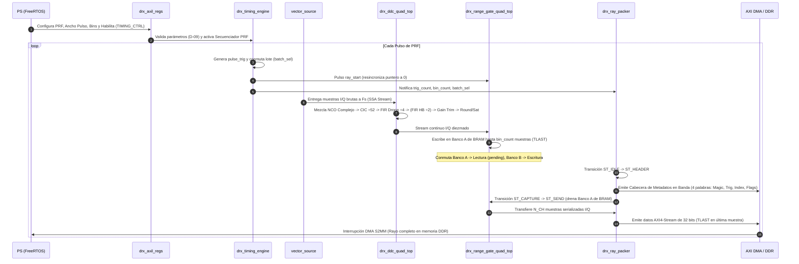

# Resumen de IPs y Arquitectura del Subsistema DRx

## Visión General

El sistema **LAMULA DRx** (Digital Receiver) implementa la recepción, conversión descendente (DDC), diezmado, sincronización de timing, empaquetado de rayos de radar y transferencia a memoria DDR mediante una arquitectura en Lógica Programable (PL) optimizada para procesado en tiempo real duro.

Esta sección documenta detalladamente cada uno de los **núcleos IP (Intellectual Property)** customizados y diseñados específicamente para el proyecto LAMULA DRx, siguiendo estándares de la industria (similares a las Guías de Producto / Product Guides PG/UG de Xilinx/AMD Vivado).

---

## Arquitectura General de la Lógica Programable (PL)

El subsistema completo reside dentro del módulo superior `drx_top` (y su envolvente `drx_zynq_top` para el Block Design de Vivado). La interconexión entre las distintas IPs se estructura en torno a tres planos de datos principales:

1. **Plano de Control y Configuración (AXI4-Lite):** Interfaz esclava que permite al Processor System (PS / FreeRTOS) configurar parámetros de timing, seleccionar modos de operación, consultar contadores BITE y limpiar banderas de estado (*Write-1-to-Clear*).
2. **Plano de Entrada de Muestras (SSA - Sample Stream Architecture):** Interfaz estandarizada `sample_stream` (AXI4-Stream con backpressure) alimentada por la IP `vector_source` (o por `jesd204b_source` en la ZU9).
3. **Plano de Salida y Streaming a Memoria (AXI4-Stream):** Flujo entrelazado multicanal con cabecera en banda generado por `drx_ray_packer`, conectado directamente al AXI DMA S2MM para transferencia por dispersión-recolección (*Scatter-Gather*) hacia la memoria DDR del PS.

---

## Diagrama de Interconexión del Subsistema (`drx_top`)

```mermaid
graph TD
    subgraph AXI4_Lite_Control ["Plano de Control AXI4-Lite"]
        PS["PS / Zynq Processing System"] -->|AXI4-Lite Bus| AXIL["IP drx_axil_regs<br/>(Controlador de Registros)"]
    end

    subgraph Sample_Ingress ["Plano de Entrada (SSA)"]
        VS["IP vector_source<br/>(BRAM-Loop / Throttled DDR)"]
    end

    subgraph Timing_Subsystem ["Plano de Timing y Sincronismo"]
        TE["IP drx_timing_engine<br/>(Motor PRF, Triggers & Checks)"]
    end

    subgraph DDC_Processing ["Plano de Procesado DDC Multicanal"]
        DDC_Q["IP drx_ddc_quad_top<br/>(Mezclador NCO + CIC + FIRs + Gain Trim)"]
    end

    subgraph Framing_Storage ["Plano de Enmarcado de Rango"]
        RG_Q["IP drx_range_gate_quad_top<br/>(Memoria Ping-Pong Dual-Bank)"]
    end

    subgraph Data_Egress ["Plano de Salida a DDR"]
        RP["IP drx_ray_packer<br/>(Empaquetador de Rayos & Cabeceras)"]
        DMA["Xilinx AXI DMA S2MM"]
    end

    %% Conexiones Control
    AXIL -->|timing_enable, prf_div, bins, etc.| TE
    AXIL -->|mode_coarse, vector_source_ddr| VS
    AXIL -->|mode_coarse| DDC_Q
    AXIL -->|overrun_clear, clear_truncated| RG_Q
    RG_Q -->|overrun_in, ray_truncated_in| AXIL
    DDC_Q -->|overflow_in| AXIL
    TE -->|radial_done, config_invalid| AXIL

    %% Conexiones Datos SSA
    VS -->|data[N_CH], valid[N_CH]| DDC_Q
    DMA -->|AXI MM2S Throttled Stream| VS

    %% Conexiones Timing
    TE -->|pulse_trig / ray_start| RG_Q
    TE -->|pulse_trig / trig_count| AXIL
    TE -->|bin_count, pulse_width, batch_sel| RP

    %% Conexiones DDC a Range Gate
    DDC_Q -->|m_i[N_CH], m_q[N_CH], m_valid[N_CH]| RG_Q

    %% Conexiones Range Gate a Packer
    RG_Q -->|s_i, s_q, s_valid, s_last| RP

    %% Conexiones Packer a DMA
    RP -->|m_data (32-bit AXI4-Stream), m_valid, m_last| DMA
    DMA -->|Escritura AXIS a DDR| PS
```

---

## Flujo de Información de Extremo a Extremo



---

## Catálogo de IPs Desarrolladas

A continuación se resume la documentación técnica individual disponible para cada IP del sistema:

| Nombre de la IP | Fichero SV | Descripción / Función | Documentación |
| :--- | :--- | :--- | :--- |
| **`vector_source`** | `rtl/vector_source.sv` | Generador de Muestras SSA con modo BRAM-Loop y modo Throttled DDR. | [Ver IP Documentación](vector_source.md) |
| **`drx_ddc`** | `rtl/drx_ddc_top.sv`<br/>`rtl/drx_ddc_quad_top.sv`<br/>`rtl/drx_ddc_mixer.sv` | Cadena DDC (Down Converter) de canal simple y multicanal con mezclador NCO elástico. | [Ver IP Documentación](drx_ddc.md) |
| **`drx_timing_engine`** | `rtl/drx_timing_engine.sv`<br/>`rtl/drx_prf_batch_seq.sv`<br/>`rtl/drx_trigger_gen.sv`<br/>`rtl/drx_timing_config_valid.sv` | Motor de Sincronismo de Radar, secuenciador de lotes PRF duales y generador de triggers. | [Ver IP Documentación](drx_timing_engine.md) |
| **`drx_range_gate`** | `rtl/drx_range_gate.sv`<br/>`rtl/drx_range_gate_quad_top.sv` | Gating de Rango y Memoria Ping-Pong Dual-Bank con desacoplo de backpressure y BITE. | [Ver IP Documentación](drx_range_gate.md) |
| **`drx_ray_packer`** | `rtl/drx_ray_packer.sv` | Empaquetador de Rayos AXI4-Stream multicanal con inserción de cabecera en banda. | [Ver IP Documentación](drx_ray_packer.md) |
| **`drx_axil_regs`** | `rtl/drx_axil_regs.sv` | Controlador Esclavo AXI4-Lite con mapa de registros, latches W1C y contadores BITE. | [Ver IP Documentación](drx_axil_regs.md) |
| **`drx_round` / `drx_saturate`** | `rtl/drx_round.sv`<br/>`rtl/drx_saturate.sv` | Módulos utilitarios de redondeo convergente simétrico y saturación de punto fijo. | [Ver IP Documentación](drx_round_saturate.md) |
