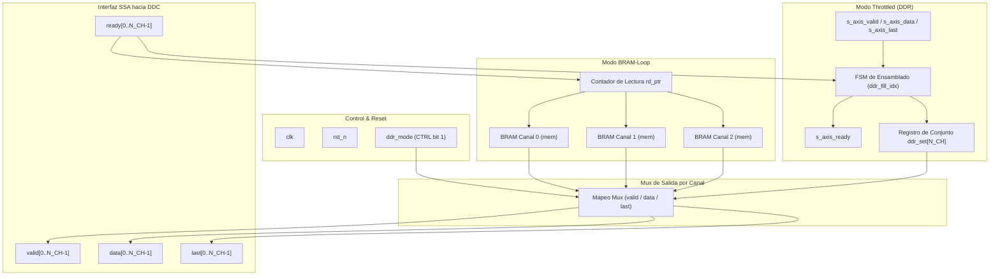
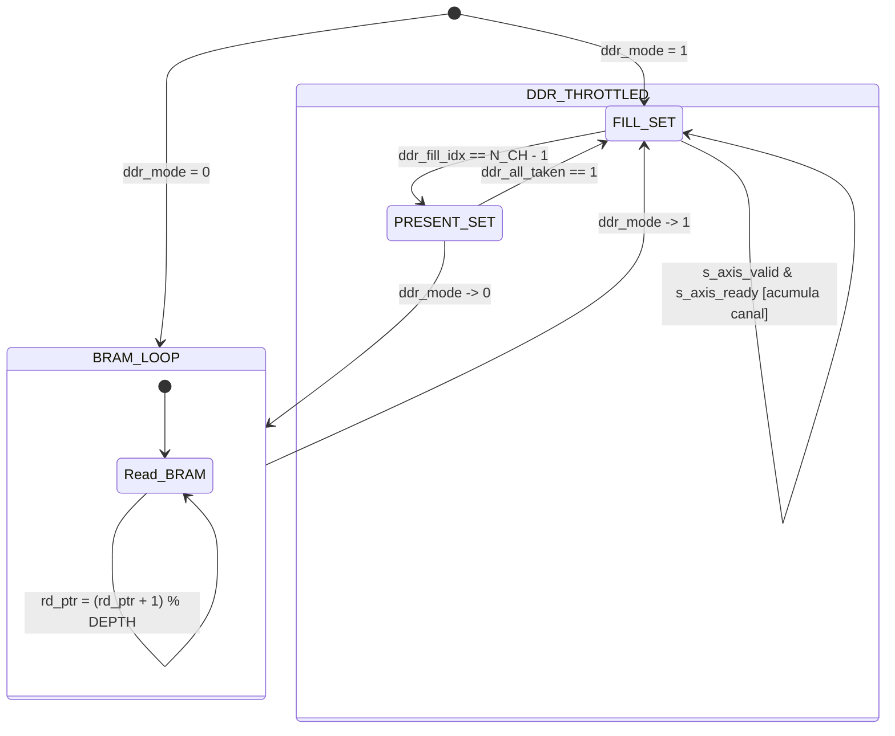

# IP Core: `vector_source` (Fuente de Muestras SSA)

## 1. Resumen

La IP **`vector_source`** es el módulo generador e inyector de muestras del receptor digital bajo la especificación **SSA (Sample Stream Architecture)**. Proporciona una interfaz unificada e intercambiable de muestras I/Q en banda base o FI para alimentar la cadena de procesado DDC (`drx_ddc_quad_top`).

Su diseño garantiza la regla fundamental del sistema: **nada aguas abajo depende de la fuente concreta de muestras**. Soporta dos modos de funcionamiento seleccionables en tiempo de ejecución:

1. **Modo BRAM-Loop (D-01):** Reproducción continua en bucle de una forma de onda precargada en bloques de memoria BRAM sintetizados, ideal para pruebas de tasa real en hardware sin depender de la DDR.
2. **Modo Throttled DDR (Z4.3):** Inyección de muestras arbitrarias leídas desde la memoria DDR del PS mediante AXI DMA MM2S a través de un bus AXI4-Stream de 16 bits entrelazado por canal, garantizando validación exacta bit a bit contra el modelo dorado.

---

## 2. Características Principales

- **Arquitectura Multicanal:** Generación paralela parametrizable para $N_{CH}$ canales ($N_{CH} = 3$ o $4$).
- **Cumplimiento Estricto SSA:** Interfaz AXI4-Stream con soporte de contrapresión (*backpressure*).
- **Conmutación Dinámica de Modo:** Alternancia entre BRAM-Loop y Throttled DDR mediante bit de control AXI-Lite (`CTRL.vector_source_ddr`).
- **Alineación de Conjunto (Set Alignment):** En modo DDR, las muestras de los $N_{CH}$ canales se presentan y retiran en bloque, asegurando sincronismo estricto de fase e instante de muestra entre canales.
- **Inferencia Limpia de BRAM:** Memoria de lectura registrada por canal sin reset asíncrono sobre la matriz de memoria, permitiendo inferencia automática de BRAM de Xilinx.
- **Inicialización parametrizada:** Precarga hexadecimal mediante `$readmemh` parametrizable (`INIT_FILE`).

---

## 3. Diagrama de Bloques

---

## 4. Descripción de Interfaces y Señales

### 4.1. Interfaces de Reloj y Control

| Nombre de Puerto | Dirección | Ancho (bits) | Protocolo | Descripción |
| :--- | :--- | :--- | :--- | :--- |
| `clk` | Entrada | 1 | Clock | Reloj principal del dominio de procesado PL (`FS_HZ`). |
| `rst_n` | Entrada | 1 | Reset | Reset global asíncrono activo en bajo. |
| `ddr_mode` | Entrada | 1 | Control | Selector de modo: `0` = BRAM-Loop, `1` = Throttled DDR. Proviene de `drx_axil_regs` (bit 1 del registro `CTRL`). |

### 4.2. Interfaz AXI4-Stream Esclava (Modo Throttled DDR)

| Nombre de Puerto | Dirección | Ancho (bits) | Protocolo | Descripción |
| :--- | :--- | :--- | :--- | :--- |
| `s_axis_valid` | Entrada | 1 | AXI4-Stream | Indica muestra válida disponible desde AXI DMA MM2S. |
| `s_axis_ready` | Salida | 1 | AXI4-Stream | Indica que la IP está lista para recibir un beat de datos. |
| `s_axis_data` | Entrada | `SAMPLE_BITS` (16) | AXI4-Stream | Palabra de datos de 16 bits con signo ($I$ o $Q$ entrelazado). |
| `s_axis_last` | Entrada | 1 | AXI4-Stream | Indica el último beat del vector transferido por DMA. |

### 4.3. Interfaz de Salida SSA Multicanal (Hacia DDC)

| Nombre de Puerto | Dirección | Ancho (bits) | Protocolo | Descripción |
| :--- | :--- | :--- | :--- | :--- |
| `ready[N_CH]` | Entrada | $N_{CH}$ | SSA Stream | Señal de contrapresión desde la cadena DDC por canal. |
| `valid[N_CH]` | Salida | $N_{CH}$ | SSA Stream | Indicador de muestra $I/Q$ válida por canal. |
| `data[N_CH]` | Salida | $N_{CH} \times \text{SAMPLE\_BITS}$ | SSA Stream | Bus de datos de muestra real de entrada $x[n]$ por canal. |
| `last[N_CH]` | Salida | $N_{CH}$ | SSA Stream | Marcador de fin de ventana por canal. |

---

## 5. Parámetros de Configuración (Generics)

| Parámetro | Tipo | Valor por Defecto | Descripción |
| :--- | :--- | :--- | :--- |
| `N_CH` | `integer` | `3` | Número de canales paralelos de procesamiento ($N_{Rx}$). |
| `DEPTH` | `integer` | `4000` | Profundidad de muestras almacenadas en cada BRAM por canal. |
| `INIT_FILE` | `string` | `""` | Ruta del fichero hexadecimal (`.hex` / `.txt`) consumido por `$readmemh` para inicializar el contenido de la BRAM. |

---

## 6. Detalles Operativos y Modos de Funcionamiento

### 6.1. Modo BRAM-Loop (`ddr_mode = 0`)

En este modo, cada canal posee un arreglo de memoria independiente inicializado durante la síntesis mediante `$readmemh(INIT_FILE, mem)`.

- Un contador de dirección de lectura `rd_ptr` recorre cíclicamente de `0` a `DEPTH - 1`.
- La lectura de la memoria está **registrada** (`out_data_r`), garantizando que Vivado inferirá primitivas BRAM dedicadas.
- La señal `last[gc]` se activa en el ciclo correspondiente a la última dirección (`DEPTH - 1`) a modo de delimitación artificial de ventana de prueba.

### 6.2. Modo Throttled DDR (`ddr_mode = 1`)

Para permitir la reproducción de vectores arbitrarios desde memoria DDR:

- El bus `s_axis_data` recibe de manera entrelazada 1 muestra por beat en orden ascendente de canales: `Ch0, Ch1, ..., Ch(N_CH-1)`.
- Una FSM interna acumula $N_{CH}$ beats en el registro de conjunto `ddr_set`.
- Una vez completado el conjunto de $N_{CH}$ muestras, la IP pasa al estado de presentación (`ddr_presenting = 1`) y eleva `valid` en todos los canales simultáneamente.
- El conjunto de datos no se retira hasta que **todos** los canales receptores han indicado aceptación mediante `ready[c] == 1` (`ddr_all_taken`).

