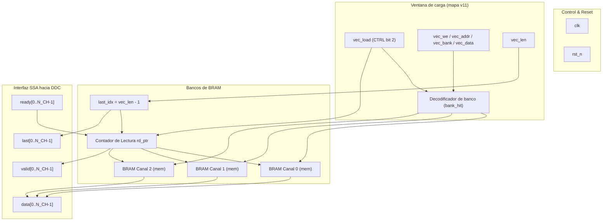
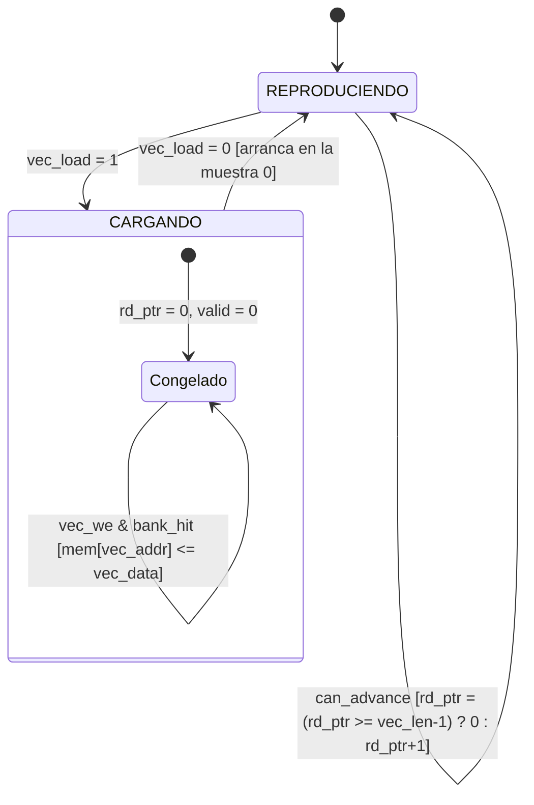

# IP Core: `vector_source` (Fuente de Muestras SSA)

## 1. Resumen

La IP **`vector_source`** es el módulo generador e inyector de muestras del receptor digital bajo la especificación **SSA (Sample Stream Architecture)**. Proporciona una interfaz unificada e intercambiable de muestras I/Q en banda base o FI para alimentar la cadena de procesado DDC (`drx_ddc_quad_top`).

Su diseño garantiza la regla fundamental del sistema: **nada aguas abajo depende de la fuente concreta de muestras**.

Implementa **un solo modo**, BRAM-Loop (D-01): reproducción continua en bucle de una forma de onda almacenada en bloques de memoria BRAM dedicados, uno por canal. Desde el **4-oct-2026** (mapa de registros v11) el contenido de esos bancos es **escribible en tiempo de ejecución** por el PS a través de una ventana AXI-Lite, de modo que el vector deja de quedar fijado en el bitstream sin dejar de entregarse a **una muestra por ciclo de reloj**.

!!! warning "Modo Throttled DDR: existió entre Z4.3 y el 4-oct-2026, y ya no está"
    Entre el 1 y el 4 de octubre de 2026 esta IP tuvo un segundo modo, seleccionable con `CTRL` bit 1: las muestras llegaban desde la DDR del PS por un AXI4-Stream de 16 bits alimentado por el canal MM2S de un AXI DMA. Resolvía el mismo problema —elegir el vector en caliente— pero entregaba **una muestra cada $N_{CH}$ ciclos**.

    Eso rompía el dato por una razón que no está en esta IP: el **DDS Compiler no tiene `aclken`** y avanza un paso de fase por ciclo de reloj mire o no `valid`, así que el DDC mezclaba a $\approx N_{CH}$ veces el IF y la salida caía al suelo de ruido (**−87,3 dBFS medidos contra −9,02 dBFS del modelo dorado**). Ver [P-16](../alcance/pendientes.md#p-16).

    La ventana de carga de v11 elimina la fuente con huecos en lugar de arreglar el NCO. **La causa raíz sigue en el diseño** para cualquier fuente con huecos futura.

---

## 2. Características Principales

- **Arquitectura Multicanal:** Generación paralela parametrizable para $N_{CH}$ canales ($N_{CH} = 3$ o $4$), con un banco de BRAM independiente por canal.
- **Tasa plena:** una muestra por ciclo y por canal mientras el consumidor acepte, sin huecos estructurales.
- **Carga en tiempo de ejecución:** el PS escribe los bancos por `VEC_ADDR` / `VEC_DATA` / `VEC_LEN` (mapa v11), bajo la protección de `CTRL` bit 2 (`vector_load`).
- **Difusión o escritura por banco:** `vec_bank = 7` escribe los $N_{CH}$ bancos a la vez; `vec_bank = c` escribe solo el canal $c$. Los bancos son independientes, así que un estímulo distinto por canal (Config A: Tx + H + V) es escribir tres veces, no un cambio de diseño.
- **Dos longitudes separadas:** `DEPTH` es la capacidad física del banco; `vec_len` es lo que se reproduce en bucle, y manda sobre `DEPTH`.
- **Cumplimiento Estricto SSA:** interfaz con soporte de contrapresión (*backpressure*) por canal.
- **Inferencia Limpia de BRAM:** un proceso de lectura y un proceso de escritura **separados**, sin sentencias compartidas y sin reset asíncrono sobre la matriz de memoria.
- **Inicialización parametrizada:** precarga hexadecimal mediante `$readmemh` (`INIT_FILE`), con `DEPTH` líneas exactas.

---

## 3. Diagrama de Bloques

---

## 4. Descripción de Interfaces y Señales

### 4.1. Interfaces de Reloj y Control

| Nombre de Puerto | Dirección | Ancho (bits) | Protocolo | Descripción |
| :--- | :--- | :--- | :--- | :--- |
| `clk` | Entrada | 1 | Clock | Reloj principal del dominio de procesado PL (`FS_HZ`). |
| `rst_n` | Entrada | 1 | Reset | Reset global asíncrono activo en bajo. No alcanza la matriz de memoria. |

### 4.2. Ventana de Carga (desde `drx_axil_regs`, mapa v11)

| Nombre de Puerto | Dirección | Ancho (bits) | Descripción |
| :--- | :--- | :--- | :--- |
| `vec_load` | Entrada | 1 | `CTRL` bit 2. En alto: congela el lector y habilita las escrituras. Al bajar, deja `rd_ptr` en 0. |
| `vec_we` | Entrada | 1 | Pulso de un ciclo por muestra. `vec_addr`, `vec_bank` y `vec_data` son válidos en **ese mismo ciclo**. |
| `vec_addr` | Entrada | `$clog2(DEPTH)` | Dirección de escritura dentro del banco, en muestras. |
| `vec_bank` | Entrada | 3 | Banco de destino: `0…N_CH-1` un canal, `7` difusión a todos. Un valor entre $N_{CH}$ y 6 no escribe en ninguno. |
| `vec_data` | Entrada | `SAMPLE_BITS` (16) | Muestra con signo. |
| `vec_len` | Entrada | `$clog2(DEPTH)` | Longitud del bucle en muestras. `0` se trata como `1`. |

### 4.3. Interfaz de Salida SSA Multicanal (Hacia DDC)

| Nombre de Puerto | Dirección | Ancho (bits) | Protocolo | Descripción |
| :--- | :--- | :--- | :--- | :--- |
| `ready[N_CH]` | Entrada | $N_{CH}$ | SSA Stream | Señal de contrapresión desde la cadena DDC por canal. |
| `valid[N_CH]` | Salida | $N_{CH}$ | SSA Stream | Indicador de muestra válida por canal. |
| `data[N_CH]` | Salida | $N_{CH} \times \text{SAMPLE\_BITS}$ | SSA Stream | Bus de datos de muestra real de entrada $x[n]$ por canal. |
| `last[N_CH]` | Salida | $N_{CH}$ | SSA Stream | Marcador de fin de ventana por canal: pulsa en la muestra `vec_len - 1`. |

---

## 5. Parámetros de Configuración (Generics)

| Parámetro | Tipo | Valor por Defecto | Descripción |
| :--- | :--- | :--- | :--- |
| `N_CH` | `integer` | `3` | Número de canales paralelos de procesamiento ($N_{Rx}$). |
| `DEPTH` | `integer` | `4000` | Capacidad **física** de cada banco, en muestras. `drx_top` lo fija a `VECTOR_BRAM_DEPTH` (8192). |
| `INIT_FILE` | `string` | `""` | Ruta del fichero hexadecimal consumido por `$readmemh`. Sin valor por defecto a propósito: la plataforma la elige `drx_top` (D-02). |
| `AddrBits` | `localparam` | `$clog2(DEPTH)` | Ancho de `vec_addr`, `vec_len` y `rd_ptr`. Está en la lista de parámetros, no en el cuerpo, porque los puertos lo necesitan. |

---

## 6. Detalles Operativos

### 6.1. Las dos longitudes, y por qué no pueden ser el mismo número

`DEPTH` es capacidad; `vec_len` es lo que suena. El puntero de lectura envuelve en `vec_len - 1`, **no** en `DEPTH - 1`.

La distinción no es un lujo: la longitud reproducida tiene que ser múltiplo de `IF_NORM_DEN` (25 en ZedBoard) para que el tono complete un número entero de periodos y no haya salto de fase al envolver, y una potencia de dos no lo es. Con `VECTOR_BRAM_DEPTH = 8192` y `VECTOR_LOOP_LEN = 4000` (ambos en `config/params.toml`, con el gate de `tools/gen_params.py` comprobando las dos condiciones), el banco son 4 RAMB36 exactos por canal y el bucle precargado ocupa la mitad.

El máximo valor útil de `vec_len` es `DEPTH - 1`: con `DEPTH` potencia de dos exacta, el propio `DEPTH` no cabe en `$clog2(DEPTH)` bits. Es la misma trampa que documenta `rtl/drx_range_gate.sv:152`, y `DrxReg_VecSetLen()` la rechaza en vez de dejarla truncar.

### 6.2. Reproducción

- Un contador `rd_ptr` por canal recorre cíclicamente de `0` a `vec_len - 1`.
- El envolvente compara con `>=` y no con `==`. Si `vec_len` se acorta con el puntero ya más allá del nuevo final, una igualdad estricta obligaría a dar la vuelta entera al banco —recorriendo la parte no cargada— antes de resincronizar. Con `>=` el bucle nuevo entra en el ciclo siguiente, al precio de una muestra fuera de rango.
- La lectura está **registrada** (`out_data_r`), y solo avanza cuando el dato anterior ya se consumió: nunca pisa una muestra no leída.
- `last[gc]` se activa en la muestra `vec_len - 1`. Es un marcador **artificial** de fin de ventana para ejercitar el framing de `drx_range_gate`, **no** el PRF real.

### 6.3. Carga

- `vec_load` en alto congela el lector (`can_advance = 0`) **y lo rearma**: `rd_ptr` a 0 y `valid` en bajo. Así una carga nueva empieza siempre en la muestra 0 y el rayo que se compara contra el modelo dorado arranca igual en cada selección.
- Las escrituras se cualifican con `vec_load` **también dentro de esta IP**, no solo en quien genera `vec_we`. Con el lector corriendo, una escritura dejaría medio vector viejo y medio nuevo sonando a la vez: sin error, sin bandera, solo un espectro raro.
- Como con `vec_load` en alto no hay lecturas, los dos puertos de la memoria nunca coinciden.

### 6.4. Inferencia de BRAM: por qué dos procesos y ninguno con reset

Vivado solo reconoce el patrón como BRAM cuando cada memoria tiene **su propio proceso de lectura y su propio proceso de escritura, sin ninguna sentencia compartida**. Con un if/else compartido —y hasta con `(* ram_style = "block" *)`— Vivado real contestó `Infeasible... trying to implement using LUTRAM`, hallazgo medido sobre `drx_range_gate.sv` el 19-sep-2026.

Ninguno de los dos procesos lleva reset asíncrono en su sensibilidad: ninguna BRAM real de Xilinx tiene borrado asíncrono de contenido, y el síntoma es `RAM is sensitive to asynchronous reset signal`. `out_data_r` viaja con la lectura por el mismo motivo; su valor tras reset no se observa nunca, porque `out_valid_r` —que sí se resetea— se lo impide a cualquier consumidor.

### 6.5. Precarga y arranque en frío

`$readmemh(INIT_FILE, mem)` precarga los `DEPTH` valores del fichero que escribe `tools/gen_vector_source_init.py`: las primeras `VECTOR_LOOP_LEN` muestras son el tono con fase cerrada y el resto ceros. El fichero tiene `DEPTH` líneas exactas a propósito — uno más corto dejaría palabras indefinidas que un `vec_len` cargado en caliente sí podría llegar a leer.

Con `vec_len` reseteando a `VECTOR_LOOP_LEN`, **un sistema que nunca escriba la ventana reproduce exactamente el bucle de v10 y anteriores**, que es la condición para que los −9,03 dBFS ya medidos en placa sigan siendo la línea base de comparación.

El `$readmemh` solo corre al cargar el bitstream. No hay forma de volver al contenido de síntesis por software: para recuperar el tono nominal hay que cargar el vector `tono_if` del catálogo, que es el mismo.

### 6.6. Lo que esta IP no puede hacer

**Releer su propia memoria.** No hay camino de lectura desde la BRAM hacia AXI-Lite, y añadirlo costaría un puerto más por banco. La verificación de que una carga es correcta es el espectro del rayo contra el modelo dorado, no un volcado de la memoria.

**Sostener un estímulo no repetitivo de la longitud de un rayo.** Un rayo en modo fino son 3689 bins × $R_1$ = 208 416 muestras por canal, o 102 tiles de BRAM por canal sobre los 140 de la pieza entera. Lo que esta IP reproduce es, y seguirá siendo, un **bucle**: no admite un perfil que dependa del rango.

---

## 7. Verificación

L0 (`sim/tb/tb_vector_source.py`, vía el shim `sim/tb_sv/vector_source_tb_dut.sv`): carga y reproducción en orden, `vec_len` mandando sobre `DEPTH`, `last` en `vec_len-1`, difusión contra escritura por banco, un banco inexistente que no escribe en ninguno, una escritura sin `vec_load` que no entra, el rearme del puntero al soltar `vec_load`, `vec_len = 0` como bucle de una muestra, y el reenganche inmediato al acortar `vec_len` en caliente.

La alineación del strobe con la dirección y el dato se verifica del lado del productor, en `sim/tb/tb_drx_axil_regs.py`, y está **comprobada por mutación**.

Esta IP no tiene caso L1: no hay IP de Xilinx en su camino y su salida es el estímulo, no un resultado que comparar contra el modelo dorado.
