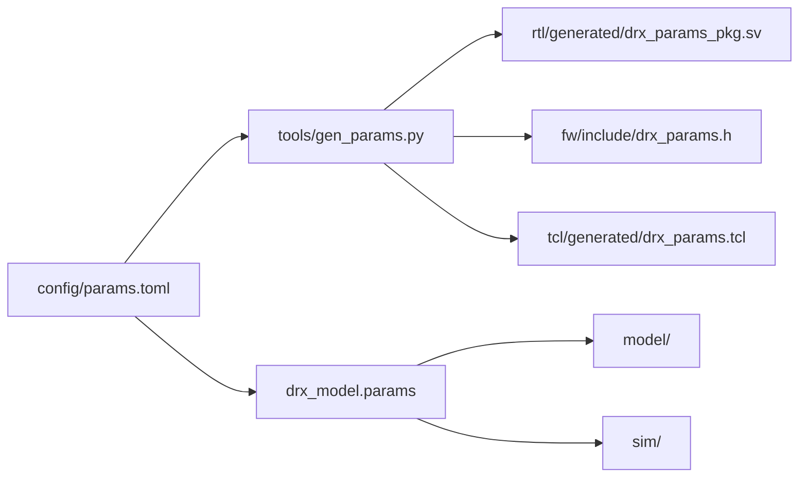

# 1 · El paquete de parámetros

## El problema que resuelve

El DRx final corre a `fs` = 250 MHz sobre una Zynq UltraScale+ ZU9. La placa que hay hoy es una
ZedBoard, cuyo XC7Z020 de grado ‑1 **no cierra temporización a 250 MHz** con un datapath de DSP no
trivial. Así que se desarrolla a 100 MHz.

La forma ingenua de hacer eso es escribir 100 MHz donde toque y cambiarlo luego. Es una trampa:
dentro de seis meses habrá divisores, anchos de contador, palabras de fase y valores de registro
repartidos por `rtl/`, `fw/`, `sim/` y `model/`, unos dilatados y otros no, y la migración a la ZU9
se convierte en una auditoría manual de cada constante del repositorio.

La alternativa —[D-02](../alcance/decisiones.md#d-02)— es **dilatar todo por igual desde un único
parámetro**. Se define `FS_HZ` una vez y todo lo demás se deriva de él.

## Qué se conserva y qué se mueve

La clave es distinguir dos clases de magnitud:

- **Lo normalizado no se mueve.** El IF dividido por `fs` vale 60/250 = 0,24 en la ZU9 y 24/100 =
  0,24 en la ZedBoard. Como la palabra de fase del NCO se calcula sobre la frecuencia normalizada,
  **es literalmente el mismo entero en las dos placas**.
- **Lo de pared se dilata.** Una PRF de 1200 Hz en la ZU9 son 480 Hz en la ZedBoard con el mismo
  valor de registro. Un pulso de 200 ciclos dura 0,8 µs allí y 2,0 µs aquí.

| Parámetro | ZU9 | ZedBoard | Relación |
|---|---|---|---|
| `fs` / reloj de fabric | 250 MHz | 100 MHz | ÷2,5 |
| IF | 60 MHz | 24 MHz | ÷2,5 |
| IF normalizado | 0,24 | 0,24 | **idéntico** |
| Palabra de fase del NCO | 1 030 792 151 | 1 030 792 151 | **idéntico** |
| Factor de diezmado R₁ | 208 | 208 | **idéntico** |
| Ancho de pulso (registro) | 200 ciclos | 200 ciclos | **idéntico** |
| PRF de pared con divisor 208 333 | 1200 Hz | 480 Hz | ÷2,5 |

La consecuencia buscada: **los vectores de estímulo y los valores esperados son bit a bit los mismos
en las dos plataformas**. Cada casilla que pone «idéntico» es una línea de test que no hay que
reescribir cuando llegue el hardware.

Hay un test que lo comprueba, no es una promesa:

```python title="model/tests/test_params.py"
def test_palabra_de_fase_del_nco_es_invariante():
    """Si esto falla, los vectores dejan de ser comunes a las dos placas."""
    assert load("zedboard").nco_phase_inc == load("zu9").nco_phase_inc
```

## Dónde vive la verdad

`config/params.toml`, en [TOML](https://toml.io/en/) porque Python lo lee con
[`tomllib`](https://docs.python.org/3/library/tomllib.html) sin añadir ninguna dependencia.

```toml title="config/params.toml (extracto)"
[invariant]
# IF normalizado = IF / fs. 60/250 en ZU9, 24/100 en ZedBoard: idéntico.
if_norm_num = 6
if_norm_den = 25

r1 = 208
r2 = 416

[chain]
cic_stages = 5
cic_rate = 52
fir_decim = 4
coarse_extra_decim = 2

[platform.zedboard]
fs_hz = 100_000_000
part = "xc7z020clg484-1"

[platform.zu9]
fs_hz = 250_000_000
part = "xczu9eg-ffvb1156-2-e"
```

Fíjate en la separación: `[invariant]` no contiene ninguna frecuencia. Si alguien mete una `fs` ahí,
la dilatación deja de funcionar en silencio — así que hay un test que lo prohíbe:

```python title="model/tests/test_params.py"
def test_el_toml_no_declara_frecuencias_fuera_de_platform():
    text = PARAMS_TOML.read_text()
    invariant_block = text.split("[invariant]", 1)[1].split("[chain]", 1)[0]
    assert "fs_hz" not in invariant_block
```

## Cómo llega a los cuatro consumidores

El paquete tiene que llegar a lenguajes que no leen TOML. La solución es generar una vista por
consumidor y **comprobar en CI que la vista está al día**:



`model/` y `sim/` no reciben copia: leen el TOML directamente. Los otros tres reciben ficheros
generados que **no se editan a mano**.

```sh
$ python3 tools/gen_params.py
escrito rtl/generated/drx_params_pkg.sv
escrito fw/include/drx_params.h
escrito tcl/generated/drx_params.tcl

$ python3 tools/gen_params.py --check
parámetros generados al día
```

Lo que sale para el RTL:

```systemverilog title="rtl/generated/drx_params_pkg.sv (extracto)"
localparam longint FS_HZ_ZEDBOARD = 100000000;
localparam longint FS_HZ_ZU9      = 250000000;

`ifdef DRX_PLATFORM_ZU9
  localparam longint FS_HZ = FS_HZ_ZU9;
`else
  localparam longint FS_HZ = FS_HZ_ZEDBOARD;
`endif

// Incremento de fase del NCO: round(IF_NORM * 2**NCO_PHASE_BITS). Invariante,
// que es justamente el punto de D-02.
localparam longint NCO_PHASE_INC = 1030792151;
```

Y para el Tcl, donde lo que hace falta no es la frecuencia sino el **periodo**, porque eso es lo que
come `create_clock`:

```tcl title="tcl/generated/drx_params.tcl (extracto)"
variable FS_HZ_ZEDBOARD 100000000
variable CLK_PERIOD_NS_ZEDBOARD 10.000000
variable PART_ZEDBOARD xc7z020clg484-1

variable FS_HZ_ZU9 250000000
variable CLK_PERIOD_NS_ZU9 4.000000
variable PART_ZU9 xczu9eg-ffvb1156-2-e
```

Por eso el XDC de la ZedBoard **no lleva `create_clock`**: el periodo lo emite `tcl/build.tcl` desde
esta variable. Un periodo escrito a mano en el XDC sería una segunda fuente de verdad.

## El gate que impide la segunda copia

Generar no basta. Nada impide que alguien escriba `100_000_000` en un módulo nuevo, y eso es
exactamente la deuda que D-02 quiere evitar. De ahí `tools/check_hardcoded_clock.py`, que **falla la
build**:

```sh
$ python3 tools/check_hardcoded_clock.py
sin constantes de reloj hardcodeadas
```

Y con una constante plantada:

```sh
$ python3 tools/check_hardcoded_clock.py /tmp/bad.sv
/tmp/bad.sv:1: constante de reloj hardcodeada: 100_000_000
    localparam int FS = 100_000_000;

1 constante(s) sospechosa(s). Deriva el valor de `FS_HZ` desde el paquete de parámetros, o si
de verdad no es un reloj añade `clock-const-ok: <razón>` en la línea.
```

Reglas del gate, y el porqué de cada una:

- **Marca literales decimales ≥ 10⁶** en `rtl/`, `fw/`, `sim/`, `model/`, `tcl/` y `contract/`.
  Cualquier frecuencia realista de este proyecto cae ahí.
- **No mira hexadecimal ni binario.** Un reloj no se escribe en hex; una máscara o un número mágico
  del contrato sí. Marcar hex sería puro ruido.
- **No mira comentarios.** Documentar «en ZedBoard son 100e6 ciclos por segundo» es justo lo que se
  quiere que la gente escriba.
- **No mira los ficheros generados.** Son el paquete de parámetros: es donde estos números deben
  estar.
- **Admite `clock-const-ok: <razón>`**, con la razón obligatoria en la misma línea. Hoy hay dos
  excepciones en todo el repositorio:

```python title="model/drx_model/params.py"
C_M_S = 299_792_458  # clock-const-ok: constante física, no un reloj
```

```python title="sim/tb/tb_drx_heartbeat.py"
CLK_PERIOD_PS = round(1e12 / PARAMS.fs_hz)  # clock-const-ok: conversión de unidades s->ps
```

Fíjate en la segunda: incluso el **periodo de reloj del testbench** se deriva de `FS_HZ`. Si mañana
`fs` cambia, el banco de simulación se mueve con ella sin tocar una línea.

## Coherencia entre lenguajes, comprobada de verdad

Que el generador escriba lo mismo en tres sitios no demuestra que los tres se lean igual. El
firmware incluye una auto-comprobación que se compila y se ejecuta en CI, imprime lo que ve, y un
test de Python lo contrasta contra el TOML:

```sh
$ build/fw/drx_params_selftest
fs_hz=100000000
if_hz=24000000
nco_phase_inc=1030792151
r1=208
r2=416
bins_mode_fine=3689
bins_mode_coarse=1844
n_rx_ch=4
sample_bits=16
iq_bits=16
cic_stages=5
cic_rate=52
fir_decim=4
fir_taps=63
platform=zedboard
params_sha256=e90ab8bb9c31092b8cab9c74acc55f0c917f5db1e544915f775296748a10b95a
```

Ese `params_sha256` es el hash del propio `config/params.toml`, incrustado en la cabecera generada:
permite que un binario en campo diga contra qué versión exacta del paquete se construyó.

El programa también asevera invariantes que no dependen del TOML:

```c title="fw/src/drx_params_selftest.c"
check(DRX_R2 == DRX_R1 * DRX_COARSE_EXTRA_DECIM,
      "R2 tiene que ser R1 por la etapa extra del modo grueso");
check(DRX_R1 == DRX_CIC_RATE * DRX_FIR_DECIM,
      "R1 tiene que ser la descomposicion CIC x FIR");
check(DRX_IF_HZ * DRX_IF_NORM_DEN == DRX_FS_HZ * DRX_IF_NORM_NUM,
      "el IF no cae en el IF normalizado declarado");
```

Y se compila también para la plataforma objetivo, aunque no haya placa:

```sh
$ make -C fw check PLATFORM=zu9
auto-comprobación de parámetros: OK
```

## Por qué esto importa ahora mismo

[P-01](../alcance/pendientes.md#p-01) y [P-08](../alcance/pendientes.md#p-08) están abiertos, y los
dos apuntan a que R₁, R₂ y puede que `fs` van a cambiar. Los candidatos vivos son R₁/R₂ = 120/240
con `fs` = 143,9 MHz, o R₂ = 417 con cadena propia.

Con el paquete de parámetros, ese cambio es esto:

```diff
 [invariant]
-r1 = 208
-r2 = 416
+r1 = 120
+r2 = 240
```

más `make gen`, más ajustar `[chain]` para que la descomposición cuadre — y hay un test que falla si
no cuadra:

```python title="model/tests/test_params.py"
def test_la_descomposicion_de_la_cadena_reproduce_r1_y_r2():
    """Gate real: cambiar R1 en el TOML sin tocar la cadena tiene que fallar aquí."""
    params = load("zedboard")
    chain = params.chain
    assert chain["cic_rate"] * chain["fir_decim"] == params.r1
    assert params.r2 == params.r1 * chain["coarse_extra_decim"]
```

Sin el paquete, ese mismo cambio sería una búsqueda por todo el repositorio con la esperanza de no
dejarse ninguno. **Esa es la razón de que el paquete de parámetros sea el primer punto de Z0 y no el
último.**

!!! warning "No lo cambies todavía"
    [D-04](../alcance/decisiones.md#d-04) está congelada provisionalmente. R₁/R₂ no se tocan sin el
    ADR que la sustituya, aunque el cambio sea de dos líneas. La facilidad del cambio no es permiso
    para hacerlo.

## Comprobar el tamaño de celda

Un detalle que confunde al leer el modelo: el tamaño de celda de rango **solo tiene significado
físico en la plataforma objetivo**. En ZedBoard el tiempo está dilatado y el número que sale no es
el que ve el radar.

```sh
$ PYTHONPATH=model .venv/bin/python -c "
from drx_model.params import load
for name in ('zedboard', 'zu9'):
    p = load(name)
    print(f'{name:9s} fs={p.fs_hz/1e6:6.1f} MHz  celda(R1)={p.cell_m(p.r1):8.3f} m  celda(R2)={p.cell_m(p.r2):8.3f} m')
"
zedboard  fs= 100.0 MHz  celda(R1)= 311.784 m  celda(R2)= 623.568 m
zu9       fs= 250.0 MHz  celda(R1)= 124.714 m  celda(R2)= 249.427 m
```

Los 249,427 m de la ZU9 son exactamente el número del que habla P-01: el que se declararía a ORPG
como 249 y haría que el radial se descartara. Por eso el modelo expone `cell_m(r)` con una
advertencia explícita en el docstring en vez de dejar que alguien lo interprete mal.

---

**Siguiente:** [2 · Aritmética de punto fijo](02-punto-fijo.md) — por qué un LSB de diferencia entre
el modelo y el RTL es un bug y no una tolerancia.
