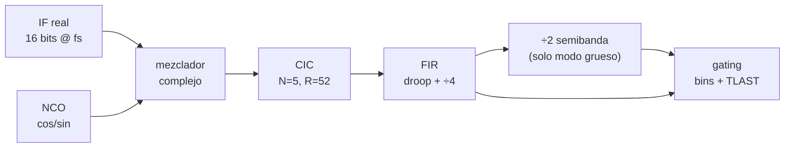
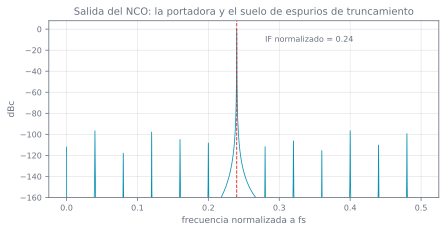
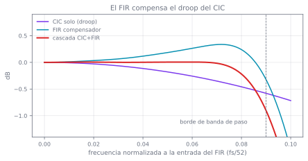
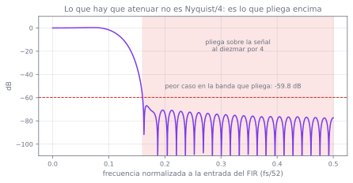
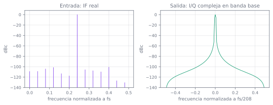

# 3 · La cadena DDC

## Qué hace y por qué

El ADC entrega el IF **real** muestreado a `fs`: en la ZU9, una señal centrada en 60 MHz muestreada a
250 MHz. Lo que el DSP necesita son muestras **complejas en banda base**, una por celda de rango, a
una tasa mil veces menor.

Esa conversión es el *digital down-converter*, y son cuatro pasos:



Los factores: 52 × 4 = **208** en modo fino, ×2 más = **416** en modo grueso. Que R₂ sea exactamente
2·R₁ no es casualidad: es lo que permite **una sola cadena con una etapa conmutable** en vez de dos
cadenas independientes, y es media
[D-04](../alcance/decisiones.md#d-04).

El modelo entero está en `model/drx_model/`, es el oráculo, y esta página lo recorre bloque a bloque.

## Paso 1 — el NCO

Un [oscilador controlado numéricamente](https://en.wikipedia.org/wiki/Numerically-controlled_oscillator)
es un acumulador de fase más una tabla. Cada muestra se suma un incremento fijo a un acumulador de
32 bits; los bits altos del acumulador direccionan una LUT de seno y coseno.

```python title="model/drx_model/nco.py"
def generate(self, n: int, initial: int = 0):
    """`(cos, sin)` cuantizados, con truncamiento de fase a la LUT."""
    shift = self.phase_bits - self.lut_addr_bits
    addr = self.phase(n, initial) >> shift
    cos_lut, sin_lut = self.lut()
    return cos_lut[addr], sin_lut[addr]
```

El incremento sale de la frecuencia normalizada, y por eso es **invariante entre plataformas**:

$$
\text{phase\_inc} = \text{round}\!\left(\frac{\text{IF}}{f_s} \cdot 2^{32}\right)
= \text{round}\!\left(\frac{6}{25} \cdot 2^{32}\right) = 1\,030\,792\,151
$$

### Qué cuesta truncar la fase

El acumulador tiene 32 bits pero la LUT solo se direcciona con 16. Los 16 bits que se tiran son un
error de fase determinista y periódico, y un error periódico en fase produce **rayas espectrales**, no
ruido. Es el modo de truncamiento de fase del
[DDS Compiler](https://docs.amd.com/r/en-US/pg141-dds-compiler), y el modelo lo reproduce porque si
no, la comparación bit a bit contra la IP no cerraría.



La portadora está donde tiene que estar, en 0,24 de `fs`. El peor espurio medido está a **−86,4 dBc**.
Para un receptor de 16 bits —cuyo suelo de cuantización teórico está en torno a −98 dBFS— es un
número que hay que mirar, y es exactamente la clase de cosa que se decide en Z1 al configurar la IP:
más bits de LUT, o *dithering* de fase, cuestan recursos y compran espurios.

Lo que el modelo garantiza hoy es que **ese suelo es reproducible y está medido**, no que sea el
definitivo.

```python title="model/tests/test_bloques.py"
def test_nco_emite_en_la_frecuencia_normalizada_del_if():
    nco = Nco.from_params(PARAMS)
    cos_w, sin_w = nco.generate(8192)
    spectrum = np.abs(np.fft.rfft(cos_w.astype(np.float64) - np.mean(cos_w)))
    peak_norm = np.argmax(spectrum) / 8192
    assert peak_norm == pytest.approx(float(PARAMS.if_norm), abs=1.0 / 8192)
```

## Paso 2 — el mezclador

Multiplicar la señal real por coseno y por −seno la baja a banda base y la convierte en compleja:

$$
i[n] = x[n]\cos(\omega n), \qquad q[n] = -x[n]\sin(\omega n)
$$

En enteros, el producto de 16×16 bits crece a 32 y hay que volver a bajarlo quitando el fondo de
escala del NCO:

```python title="model/drx_model/chain.py"
def mix(self, x):
    cos_w, sin_w = self.nco.generate(x.size)
    shift = self.params.invariant["nco_out_bits"] - 1
    i = fixed.shift_round(x * cos_w, shift)
    q = fixed.shift_round(-x * sin_w, shift)
    return i, q
```

El desplazamiento es 15, no 16, porque el fondo de escala positivo de 16 bits es 2¹⁵−1. Y es
`shift_round`, no `shift_truncate`, por lo que vimos en [la página anterior](02-punto-fijo.md).

Producto de un tono por un coseno de la misma frecuencia: aparece un término en continua y otro al
doble de frecuencia. El primero es la señal; el segundo lo tiene que matar el filtro que viene ahora.

## Paso 3 — el CIC

Un [filtro CIC](https://en.wikipedia.org/wiki/Cascaded_integrator%E2%80%93comb_filter) es la forma
barata de diezmar mucho: **no tiene multiplicadores**. Son N integradores a la tasa alta, un
diezmado, y N peines a la tasa baja.

```python title="model/drx_model/cic.py"
# Integradores. `cumsum` sobre int64 envuelve módulo 2**64, y como 2**bits
# divide a 2**64, los `bits` bits bajos son los correctos: es la misma
# aritmética que el registro del hardware.
for _ in range(self.stages):
    acc = fixed.wrap(np.cumsum(acc), bits)

acc = acc[self.rate - 1 :: self.rate]        # diezmado

delay = self.diff_delay
for _ in range(self.stages):
    delayed = np.concatenate([np.zeros(delay, dtype=np.int64), acc[:-delay]])
    acc = fixed.wrap(acc - delayed, bits)
```

### El truco que hay que entender

Un integrador puro es inestable: acumula sin límite y desborda. En un CIC eso **es correcto**, y es
el resultado de Hogenauer: el desbordamiento de los integradores se cancela exactamente en los peines
siempre que todos los registros tengan al menos

$$
B_{\text{out}} = B_{\text{in}} + \lceil N\log_2(RM)\rceil
$$

bits. Con N=5, R=52, M=1 y 16 bits de entrada:

```
CIC gain 380204032   growth 29   reg 45
```

380 204 032 = 52⁵, 29 bits de crecimiento, **45 bits de registro**. Ese es el número que determina
cuántos DSP48 y cuánta lógica cuesta el CIC en la FPGA, y sale de una fórmula, no de una estimación.

Es también la razón por la que el modelo usa `wrap` y no precisión infinita: un modelo con enteros
grandes de Python daría **otro resultado en los transitorios** y la comparación bit a bit contra el
[CIC Compiler](https://docs.amd.com/r/en-US/pg079-cic-compiler) fallaría sin que hubiera ningún bug.

```python title="model/tests/test_bloques.py"
def test_ganancia_en_continua_del_cic():
    """(R·M)^N exacta: cualquier otra cosa es un error de escalado."""
    cic = _cic()
    steady = cic.process(np.full(cic.rate * 20, 1, dtype=np.int64))
    assert steady[-1] == cic.gain == cic.rate**cic.stages
```

### El precio: el droop

El CIC no es un filtro plano. Su respuesta es

$$
|H(f)| = \left|\frac{\sin(\pi f R M)}{\sin(\pi f)}\right|^{N}
$$

que cae monótonamente dentro de la banda de paso. En el borde de banda útil la caída medida es
**−0,580 dB**. Eso deforma el espectro de la señal y hay que corregirlo.

## Paso 4 — el FIR, que hace dos trabajos

El [FIR Compiler](https://docs.amd.com/r/en-US/pg149-fir-compiler) hace a la vez:

1. **Compensar el droop**: su respuesta en banda de paso es aproximadamente el inverso de la del CIC.
2. **Antialiasar el diezmado ÷4** que viene después.

Los coeficientes se diseñan con
[`scipy.signal.firwin2`](https://docs.scipy.org/doc/scipy/reference/generated/scipy.signal.firwin2.html)
—muestreo en frecuencia, que admite una respuesta deseada arbitraria, justo lo que hace falta para
invertir una curva— y se **congelan** en `config/coeffs/`:

```python title="tools/gen_coeffs.py"
# Banda de paso: el inverso del droop del CIC. La frecuencia del CIC está
# normalizada a fs, así que hay que dividir por su factor de diezmado.
passband = grid <= PASSBAND_EDGE
droop = cic.response(grid[passband] / cic.rate)
desired[passband] = droop[0] / droop  # 1 en continua, sube donde el CIC cae
```

Se congelan y no se rediseñan en cada ejecución por una razón concreta: **son los coeficientes que se
cargan en la IP**, y si el modelo los recalculara, una actualización de SciPy movería el oráculo por
debajo sin que nadie lo notara.

```
# GENERADO por tools/gen_coeffs.py. NO EDITAR A MANO.
# CIC: N=5 R=52 M=1
# FIR: taps=63 decim=4 coeff_bits=18
# Bandas (norm. a la fs de entrada del FIR): paso<=0.09 eliminada>=0.14 alias>=0.160
# Ganancia de continua entera: 552725
```

### Resultado



| Banda medida | CIC solo | Cascada CIC+FIR |
|---|---|---|
| 0 – 0,06 | 0,257 dB de caída | **0,006 dB de rizado** |
| 0 – 0,09 (banda de paso completa) | 0,580 dB | 0,909 dB |

Y aquí va un resultado honesto que la gráfica enseña y conviene no maquillar: **la compensación es
excelente en los dos tercios interiores de la banda y empeora en el borde**. En 0…0,06 el rizado baja
de 0,257 dB a 0,006 dB, un factor 40. Pero al llegar a 0,09 el compensador sobrepasa y la cascada
tiene más rizado que el CIC solo.

Es una consecuencia directa del compromiso de diseño: 63 taps, una banda de transición estrecha y una
ventana de Hamming. **No es un bug, es un punto de diseño mejorable**, y le toca a Z1 afinarlo contra
el cierre de recursos real del FIR Compiler. El test de CI asevera el tramo bueno; este documento
declara el malo.

### El error de diseño que sí hubo, y cómo se encontró

La primera versión puso el borde de banda eliminada en 0,125 —Nyquist dividido por el factor de
diezmado— porque parecía lo natural. Es incorrecto. Lo que hay que atenuar no es «todo lo que pase de
Nyquist/4», sino **lo que pliega encima de la banda de paso al diezmar**, que empieza en

$$
0{,}25 - 0{,}09 = 0{,}16
$$

Con el borde en 0,125 y 63 taps, la transición era demasiado abrupta y el alias real quedaba en
−23 dB. Moviendo el borde a 0,14 —más cerca de la banda de paso, con la transición terminada antes de
que empiece a plegar— el mismo filtro da **−58,7 dB**:



Lo encontró un test que asertaba la atenuación en la banda equivocada, se corrigió el test y con él el
diseño. Es el argumento entero a favor de tener el modelo antes que el RTL: este error, descubierto
en Z1 con la IP ya generada, habría costado una regeneración y un ciclo de síntesis.

## Paso 5 — la etapa ÷2 del modo grueso

El modo de celda grande añade un semibanda de 23 taps. Sus números medidos:

| Métrica | Valor |
|---|---|
| Atenuación en la banda que pliega (≥0,35) | **−69,4 dB** |
| Rizado de banda de paso (0…0,15) | 1,20 dB |

El rizado de 1,2 dB es alto y está anotado como tal en el propio fichero de coeficientes: aceptable
para Z0, lo afina Z1. El modo grueso se queda con la mitad del ancho de banda del fino, y esa es la
contrapartida de la celda del doble de tamaño.

## La cadena completa

```python title="model/drx_model/chain.py"
def _decimate(self, branch):
    out = self.cic.process(branch)
    # Se quita la ganancia del CIC en un único punto y de forma explícita.
    out = fixed.shift_round(out, self.cic.growth_bits)
    out = self.fir.process(out)
    out = fixed.shift_round(out, fixed.growth_bits(abs(self.fir.dc_gain)))
    if self.mode == MODE_COARSE:
        out = self.halfband.process(out)
        out = fixed.shift_round(out, fixed.growth_bits(abs(self.halfband.dc_gain)))
    return out
```

Un tono en el IF entra por la izquierda; sale una I/Q compleja en continua a `fs`/208:



Medido sobre un tono de −3 dBFS y 60 000 muestras:

| Modo | R | Muestras de salida | \|I+jQ\| medio | Desviación relativa |
|---|---|---|---|---|
| fino | 208 | 288 | 4330,0 | **0,00** |
| grueso | 416 | 144 | 2709,0 | **0,00** |

Desviación exactamente cero: la amplitud de salida es **constante bit a bit**, que es lo que tiene
que pasar cuando bajas un tono puro a continua con el NCO en la frecuencia exacta. Si hubiera un
error de frecuencia residual, la fase giraría; si hubiera un error de escalado, la amplitud
respiraría.

### Sobre la ganancia neta

La entrada tiene pico 23 197 y la salida amplitud 4330. Hay pérdida, y es deliberadamente visible: en
cada punto de recorte se quita la ganancia de la etapa redondeando a la potencia de dos superior, así
que la cadena pierde algunos dB y el modo grueso pierde 6 dB más que el fino. El escalado a fondo de
escala es trabajo de Z1 —«escalado de ganancia y saturación con reporte de overflow»— y aquí está
dejado explícito y medible en vez de escondido en un factor mágico.

## Paso 6 — el enrejado en rango

Después del diezmado, **un bin de rango es exactamente una muestra**: el promediado ya lo hizo la
cadena. Lo único que queda es trocear el flujo en rayos y marcar el último de cada uno con `TLAST`.

```python title="model/drx_model/gating.py"
def gate(i, q, bins: int) -> list[Ray]:
    """Trocea en rayos de `bins` muestras.

    El último rayo puede quedar incompleto si el vector se acaba; se devuelve
    marcado como truncado en vez de descartarlo en silencio, porque un rayo corto
    en la placa es un fallo que el BITE tiene que ver.
    """
```

```python
>>> np.flatnonzero(gating.tlast_mask(30, bins=10))   # posiciones de TLAST
array([ 9, 19, 29])
```

Conteo de bins por modo, desde el paquete de parámetros: **3689** en fino y **1844** en grueso.

!!! note "Ese 1844 es el número de P-01"
    1844 bins de 249,41 m es la consecuencia aritmética de R₂ = 416, y son cuatro bins por encima del
    tope duro de 1840 de ORPG. No es un detalle del modelo: es el hallazgo abierto
    [P-01](../alcance/pendientes.md#p-01), y por eso el conteo vive en el paquete de parámetros y no
    escrito dentro de un módulo.

## La huella del oráculo

Un oráculo que cambia de valor sin que nadie lo decida no es un oráculo. Los tests fijan el SHA-256 de
la salida del modelo para un vector conocido:

```python title="model/tests/test_chain.py"
GOLDEN = {
    MODE_FINE: (192, "edf20575a4b82e3b96a2bd4333b60e0922e69cd1554ab7504154eb2aadcd6cca"),
    MODE_COARSE: (96, "d51dee4c0b61b30ea7a93dd6dd3aa5ca0d1c56e2f37b8979913d5ec4bef76feb"),
}
```

Si cambias un modo de redondeo, un coeficiente o un punto de recorte, este test falla. Eso es
deliberado: obliga a justificar en el commit por qué cambió el oráculo, en lugar de que se mueva sin
que nadie lo vea.

## Los vectores de estímulo

`model/drx_model/vectors.py` genera lo que consumen por igual el modelo y el `vector_source` del RTL:
tono puro, dos tonos, barrido por toda la zona de Nyquist, impulso, escalón, y tono modulado con
desbalance I/Q. Más las degradaciones: ruido gaussiano a un SNR dado, offset de continua y entrada
sobre-escala.

Dos decisiones que merecen explicación:

**Todo se pide en frecuencia normalizada, nunca en Hz.** Así un vector generado con los parámetros de
la ZedBoard y otro con los de la ZU9 son la misma secuencia de enteros. Hay un test:

```python title="model/tests/test_gating_y_vectores.py"
def test_los_vectores_son_identicos_en_las_dos_plataformas():
    """La consecuencia buscada de D-02: un vector, dos placas."""
    assert np.array_equal(vectors.tone(load("zedboard"), 2048),
                          vectors.tone(load("zu9"), 2048))
```

**Toda función aleatoria exige semilla.** Sin argumento por defecto:

```python title="model/tests/test_gating_y_vectores.py"
def test_el_ruido_exige_semilla():
    with pytest.raises(TypeError):
        vectors.add_noise(vectors.tone(PARAMS, 128), 20.0, PARAMS)
```

Un oráculo que cambia entre ejecuciones no sirve para comparar bit a bit.

Y una nota de física que conviene no perder: **el desbalance I/Q se inyecta en banda base, antes de
subir al IF**, porque es ahí donde lo introduce un frontal en cuadratura. Con muestreo de IF real el
ADC no mete desbalance; entra por delante. Modelarlo en el sitio equivocado daría una robustez falsa.

---

**Anterior:** [2 · Aritmética de punto fijo](02-punto-fijo.md) ·
**Siguiente:** [4 · Simulación](04-simulacion.md)
