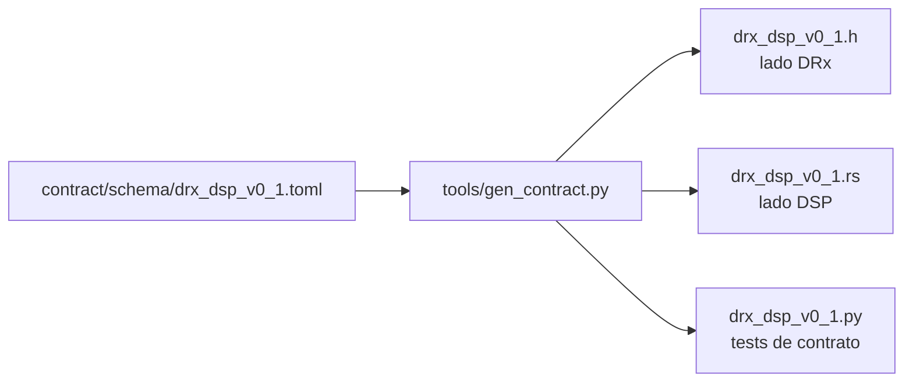

# 5 · El contrato DRx↔DSP

## Por qué se congela ahora y no al final

El DRx tiene **una sola interfaz externa**: el contrato con el
[LAMULA DSP](../alcance/contexto.md). No habla con el RCP ni con ORPG. Eso hace del contrato la única
superficie donde este proyecto puede romperle el trabajo a otro equipo.

[D-08](../alcance/decisiones.md#d-08) separa dos cosas que suelen ir juntas y no deberían:

- **Definir el esquema.** Coste bajo, dependencia externa alta — hay que ponerse de acuerdo con otro
  equipo. Va en Z0.
- **Implementar el transporte.** Coste medio, dependencia externa nula. Va en Z4.

Cuanto más tarde se congele el esquema, más caro es el rebote. Y si el equipo DSP no está listo, la
decisión es congelar **una v0.1 versionada unilateralmente** y negociar sobre algo concreto en lugar
de sobre nada. Eso es lo que hay hoy.

El otro lado es un servicio en [Rust](https://www.rust-lang.org/) sobre Linux, así que el contrato
tiene que cruzar la frontera C↔Rust sin que nadie escriba dos veces la misma estructura a mano.

## Una fuente, tres lenguajes



`AGENTS.md` lo dice sin ambigüedad: *el esquema vive en `contract/` como fuente única y genera código
para los dos lados; no escribas las dos implementaciones a mano*. La tercera, la de Python, existe
para poder comprobar las otras dos.

## Las reglas del formato, y el porqué de cada una

```toml title="contract/schema/drx_dsp_v0_1.toml"
# Reglas del formato:
#   * Little-endian, empaquetado, sin relleno implícito. Todo relleno es un campo.
#   * Solo enteros en el cable. Nada de coma flotante: el DRx y el DSP tienen que
#     estar de acuerdo bit a bit y los formatos flotantes no lo garantizan entre
#     arquitecturas y compiladores distintos.
#   * Los ángulos viajan como cuenta CRUDA del encoder, no en grados. La
#     conversión a grados necesita constantes de calibración, y ese es trabajo del
#     consumidor: el DRx no debe perder información redondeando.
```

**Relleno explícito.** Cada byte de padding es un campo con nombre (`pad0`, `pad1`) que vale cero. Si
el relleno fuera implícito, dependería del compilador y de la arquitectura, y el layout dejaría de ser
del esquema para pasar a ser de quien compiló.

**Sin coma flotante.** No es purismo: es que el objetivo del contrato es acuerdo bit a bit, y el
comportamiento de redondeo de flotantes entre arquitecturas y niveles de optimización no lo garantiza.

**Ángulos crudos.** Convertir a grados exige constantes de calibración que el DRx puede no tener
todavía. Convertir pronto pierde información de forma irreversible; pasar la cuenta cruda no.

**La corrección AFC va como palabra de fase absoluta**, no como offset en Hz:

```toml
[[message]]
name = "afc"
doc = """Corrección AFC: nueva palabra de fase del NCO, calculada por el DSP.

Viaja como palabra de fase absoluta y no como offset en Hz a propósito: en Hz
haría falta que el DSP conociera `FS_HZ` del DRx, y eso rompería D-02 en cuanto
las dos plataformas divergieran."""
```

Esto es [D-02](../alcance/decisiones.md#d-02) atravesando la frontera del proyecto: si el DSP tuviera
que saber a qué `fs` corre el DRx para calcular una corrección, la dilatación temporal dejaría de ser
un detalle interno.

## Los mensajes

| Mensaje | ID | Sentido | Tamaño | Para qué |
|---|---|---|---|---|
| `ray` | 1 | DRx → DSP | 36 B + carga | Cabecera de rayo; detrás van los pares (I,Q) |
| `status` | 2 | DRx → DSP | 28 B | Status y BITE |
| `config` | 3 | DSP → DRx | 48 B | Configuración completa, atómica |
| `config_ack` | 4 | DRx → DSP | 8 B | Aceptado, o rechazado con código |
| `afc` | 5 | DSP → DRx | 16 B | Retune del NCO |

Más una cabecera común de 12 bytes. Los tamaños no son estimaciones: salen de la salida real del
programa de prueba en C.

```sh
sizeof header=12 ray=36 status=28 config=48 config_ack=8 afc=16
```

### Un rayo, de verdad

```c title="contract/generated/drx_dsp_v0_1.h (extracto)"
typedef struct __attribute__((packed)) {
  uint32_t seq;             /* Contador de rayos, envuelve. Detecta pérdidas. */
  uint64_t timestamp_ns;    /* Instante del trigger, reloj del DRx. */
  uint32_t trigger_count;   /* Disparos desde el arranque. */
  uint32_t azimuth_raw;     /* Cuenta cruda del encoder SSI de azimut. */
  uint32_t elevation_raw;   /* Cuenta cruda del encoder SSI de elevación. */
  uint32_t prf_div;         /* Divisor de PRF vigente. PRF = FS_HZ/prf_div. */
  uint16_t bins;            /* Bins de rango en este rayo. */
  uint8_t pulse_width_idx;  /* Índice en la tabla de anchos de pulso. */
  uint8_t pulse_mode;       /* Modo de pulso vigente. */
  uint8_t cell_mode;        /* 0 = celda fina, 1 = celda gruesa. */
  uint8_t n_channels;       /* Canales presentes en la carga útil. */
  uint8_t channel_mask;     /* Qué canales físicos son, bit por canal. */
  uint8_t ray_flags;        /* Ver la tabla de banderas de rayo. */
} drx_dsp_ray_t;
_Static_assert(sizeof(drx_dsp_ray_t) == 36, "layout de drx_dsp_ray_t");
```

Ese `_Static_assert` es la primera línea de defensa: **si el compilador mete relleno, el firmware no
compila**. Es la clase de comprobación que cuesta nada y evita un día entero de depuración de un
desplazamiento de dos bytes.

Y lo mismo generado para el otro lado:

```rust title="contract/generated/drx_dsp_v0_1.rs (extracto)"
#[repr(C, packed)]
#[derive(Debug, Clone, Copy, PartialEq, Eq, Default)]
pub struct Ray {
    /// Contador de rayos, envuelve. Detecta pérdidas.
    pub seq: u32,
    /// Instante del trigger, reloj del DRx.
    pub timestamp_ns: u64,
    ...
}
pub const RAY_SIZE: usize = 36;
```

### Las banderas de rayo dicen algo sobre la filosofía

```toml
[[enum]]
name = "ray_flag"
doc = "Banderas por rayo. Un rayo con problemas se MARCA, no se descarta."
values = [
  { name = "azel_invalid", value = 1, doc = "Lectura de encoder inválida en este rayo." },
  { name = "ddc_overflow", value = 2, doc = "Hubo saturación en el DDC dentro del rayo." },
  { name = "truncated", value = 4, doc = "El rayo salió corto." },
  { name = "first_after_config", value = 8, doc = "Primer rayo con la configuración nueva." },
]
```

Marcar en vez de descartar viene del plan de testing: ante un glitch de encoder, el comportamiento
esperado es *rayo marcado como az/el inválido, **no** descartado*. El consumidor decide qué hacer con
un dato dudoso; el productor no decide por él.

### Los códigos de error, y el que viene de D-09

```toml
{ name = "prf_range_illegal", value = 1, doc = "PRF y extensión de rango incompatibles (D-09)." },
```

[D-09](../alcance/decisiones.md#d-09) sale de una observación incómoda: el plan original enumeraba
«PRF 200–1200 Hz» y «alcance hasta 460 km» como si fueran independientes, y no lo son. El rango no
ambiguo es `c/(2·PRF)`, así que 460 km a 1200 Hz es **físicamente imposible**. El manejador de
configuración tiene que rechazar esas combinaciones con un código definido, y ese código vive aquí
desde Z0 aunque la validación se implemente en Z2.

```python title="contract/tests/test_contract.py"
def test_el_codigo_de_error_de_d09_existe():
    """D-09: rechazar PRF × rango ilegal con un código definido en el contrato."""
    module = _py_module()
    assert module.Error.PRF_RANGE_ILLEGAL == 1
    assert module.Error.OK == 0
```

## Cómo se comprueba que los lados no divergen

Que el generador escriba tres ficheros no demuestra que los tres se lean igual. El test de contrato
**compila un programa en C**, lo ejecuta, y compara sus bytes con los que produce la implementación de
Python.

Una cabecera de rayo para un radial de 1844 bins × 4 canales:

```sh
$ gcc -std=c11 -Wall -Wextra -Werror -Icontract/generated dump.c -o dump && ./dump
52 44 4d 4c 00 01 01 00 64 73 00 00

$ .venv/bin/python dump.py
52 44 4d 4c 00 01 01 00 64 73 00 00
```

Byte a byte idénticos. Y se leen así:

| Bytes | Campo | Valor |
|---|---|---|
| `52 44 4d 4c` | `magic` | 0x4C4D4452, que es `"LMDR"` en ASCII leído little-endian |
| `00` | `version_major` | 0 |
| `01` | `version_minor` | 1 |
| `01` | `msg_type` | 1 = `ray` |
| `00` | `flags` | reservado en v0.1 |
| `64 73 00 00` | `payload_len` | 0x7364 = 29 540 = 36 + 1844 × 4 canales × 4 bytes |

Ese `payload_len` es la aritmética del contrato funcionando: la cabecera de 36 bytes más un radial
completo de reflectividad en modo grueso.

El test lo hace para **todos** los mensajes, con valores deterministas por posición de campo:

```python title="contract/tests/test_contract.py"
def _sample_value(index: int, type_name: str) -> int:
    """Valor determinista por posición, recortado al ancho del campo."""
    return (0x0102030405060708 * (index + 1)) & ((1 << (8 * WIDTH[type_name])) - 1)
```

Un patrón así detecta campos intercambiados, no solo tamaños mal: si dos campos del mismo ancho están
en orden distinto en C y en Python, los bytes salen distintos.

## Lo que este test **no** comprueba

Hay que decirlo claro:

```python title="contract/tests/test_contract.py"
"""
Lo que NO se comprueba todavía, y hay que decirlo: **la implementación de Rust no
se compila aquí** porque no hay toolchain de Rust en este repositorio. El lado DSP
tiene que añadir su propio test de layout contra `drx_dsp_v0_1.rs`. Sí se
comprueba que las constantes de tamaño de Rust coinciden con las de C y Python,
que es lo que atrapa un error de codegen.
"""
```

O sea: un error del **generador** se detecta aquí; un error de cómo Rust dispone la estructura en
memoria, no. Ese test le toca al proyecto DSP, y es una de las cosas concretas que hay que pedirles
cuando se les entregue la v0.1.

## Cómo añadir un campo

1. Edítalo en `contract/schema/drx_dsp_v0_1.toml`, con su `doc`. Si desalinea, añade un `padN`
   explícito.
2. Sube `version_minor` si es compatible hacia atrás, o `version_major` si no lo es.
3. `make gen`.
4. `make check`. El test de contrato recompila el C y vuelve a comparar bytes.
5. Avisa al proyecto DSP. Un contrato que cambia sin avisar no es un contrato.

Lo que **no** hay que hacer nunca es editar `contract/generated/`. El CI lo detecta:

```sh
$ python3 tools/gen_contract.py --check
contrato generado al día
```

---

**Anterior:** [4 · Simulación](04-simulacion.md) ·
**Siguiente:** [6 · Gateware](06-gateware.md)
